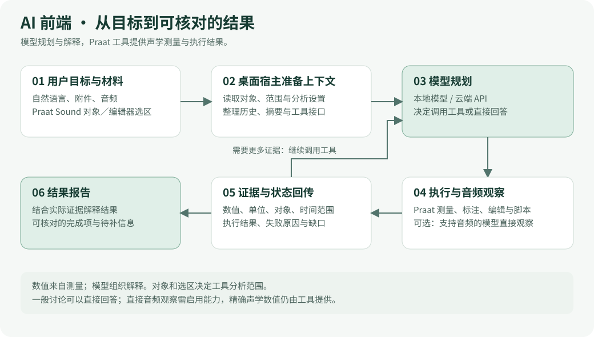

  
  <h1>AIPraat</h1>
  
Praat 简体中文版 + AI 声学分析工作台 + 标准音对比纠音

  
<a href="https://github.com/f246813/praat-simplified-chinese-ai/releases/latest">下载最新版</a> · <a href="ai/README.zh-CN.md">使用说明</a> · <a href="CREDITS.zh-CN.md">借物表</a>

用自然语言调用 Praat 的测量工具，把标准音与学习者录音放在一起比较，也可以从 Anki 卡片一键打开语图。声学测量由 Praat 和分析程序完成，模型负责规划与解释。

## 相比基座，增加了什么？

| 功能 | 可以做什么 |
| --- | --- |
| **AI 工作台** | 使用本地模型或云端 API 对话；支持附件、会话搜索、分组、归档、分叉，以及上下文用量与摘要管理。 |
| **自然语言操作 Praat** | 读取当前 Sound 对象与编辑器选区，查询基频、强度、共振峰、VOT、嗓音与频谱参数；支持 TextGrid 标注、声音编辑、导出及社区脚本。 |
| **标准音对比纠音** | 输入标准音、学习者录音与目标音位，经过对齐和声学对比，生成 JSON、TextGrid 与叠加图。英语（美式）和日语（标准语）可选实验性音位判据。 |
| **Anki 连接** | 在有音频的卡片上添加“查看语图”按钮，也可复用放大镜入口；多音频卡片支持选择声音，支持指定起止时间字段。 |
| **环境配置与音频读取** | 提供 Python、运行库、本地模型、对齐资源和 FFmpeg 的配置入口。音频先尝试原生读取，失败后使用 FFmpeg 备用解码。 |

例如，在声音编辑器中选中一段音频后输入：**“测量这段的平均基频和 F1、F2，并解释结果。”** 工作台会调用工具取得测量结果，再组织说明。工具支持的范围和参数见[使用说明](ai/README.zh-CN.md)。

## 实际界面

### AI 工作台

在同一个窗口里管理会话、输入分析目标、添加材料并查看结果。

### 模型设置

可配置本地模型或云端 API，调整上下文、思考与工作流程；文字连接与音频能力分别验证。

### 对比纠音与 Anki

纠音表单选择标准音与学习者录音，填写目标音位；Anki 连接页提供卡片入口与插件导出。

  
  

截图取自 2026-10-14 打开的 Windows 软件界面。纠音图展示输入表单；截图来源与捕获方式见[图像说明](docs/pictures/aipraat/README.md)。

## AI 前端怎样工作？

用户提供目标与材料，宿主读取 Praat 对象和选区，模型选择工具；工具返回实际测量与执行结果，模型可据此继续调用，最后形成报告。支持音频输入的模型也可在启用后直接观察音频。

### AI 对话窗口的后端

下面展开桌面宿主、任务路由和云端 API 的 **L0–L4 阶梯**：L0 执行专用工具，L1 进行有限纠正，L2 依据证据解释目标，L3 在显式请求或自动升级条件满足时分析原音频，L4 处理一般讨论。图中同时标出本地 Qwen 的独立路径、共享预算、Praat 投递、结果持久化和继续分析。

各层按目标与工作流程策略进入；L1 纠正成功返回 L0，L3 音频不可用时返回 L2 使用已有证据。点击图片可查看完整尺寸。

## AI 对比纠音怎样工作？

标准音与学习者录音先定位音素区间，再提取适用声学特征。旧式路径使用曲线对齐与偏差阈值；新音位判据按音类生成声学或相对时长观察，并记录证据状态。基础报告无需 LLM，Qwen 文字／视觉解释是可选步骤。

**当前范围：** 英语、日语音位判据仍是实验性观察；需要填写目标音位并配置适用的对齐资源，或提供双方边界。比例定位、低质量对齐和缺失测量会标记为证据不足。尚未实现独立音素识别或经过校准的发音总分。详细规则见 [v8.0.3 音位判据说明](https://github.com/f246813/praat-simplified-chinese-ai/blob/v8.0.3/docs/2026-10-13-%E9%9F%B3%E4%BD%8D%E5%88%A4%E6%8D%AE%E5%AE%9E%E6%96%BD%E8%AF%B4%E6%98%8E.md)。

## 下载与开始使用

1. 从 [最新 Release](https://github.com/f246813/praat-simplified-chinese-ai/releases/latest) 下载 **AIPraat-install.exe**，按安装引导配置 Python 与运行库。
2. 打开 Praat，在“前端 → 启动前端”进入工作台；按需要配置本地模型或云端 API。
3. 使用 Anki 时，同页下载 **AIPraat.ankiaddon**，在 Anki 的“工具 → 插件 → 从文件安装”中安装并重启。先启动一次 AIPraat 并完成 Python 配置，插件即可定位软件。

[AI 使用说明](ai/README.zh-CN.md) · [Anki 连接说明](ai/Anki连接说明.md) · [安装与打包](installer/README.zh-CN.md)

## 基座与上游

本项目基于 [KasumiKitsune/praat-simplified-chinese](https://github.com/KasumiKitsune/praat-simplified-chinese) 的 modern 分支：中文界面、中文手册及现代版原生界面来自该项目。原版 Praat 是 Paul Boersma 与 David Weenink 开发的语音学分析软件：[praat/praat](https://github.com/praat/praat) · [praat.org](https://praat.org)。

  
  

上面两张图片沿用基座仓库。本项目由 f246813 维护，与基座及上游没有隶属关系。

## 借物与开发资料

感谢基座、Praat 上游，以及社区脚本、AI 框架、前端组件、对齐模型与音位特征库的作者。完整用途、复用范围和许可见 **[借物表](CREDITS.zh-CN.md)**；资源包来源见[发音词典与模型参考](发音词典与模型参考/来源及网址.md)。

[前端源码来源](docs/ai-frontend/FRONTEND-SOURCES.md) · [设计记录](ai/docs/adr/README.md) · [维护说明](guide.md) · [测试记录](test-records/README.md) · [单平台构建](HOW_TO_BUILD_ONE.md)

代码许可为 [GPL-3.0-or-later](LICENSE)；文档、图片与第三方资源的许可分别见 [docs/LICENSE.txt](docs/LICENSE.txt)、借物表及各资源目录。
