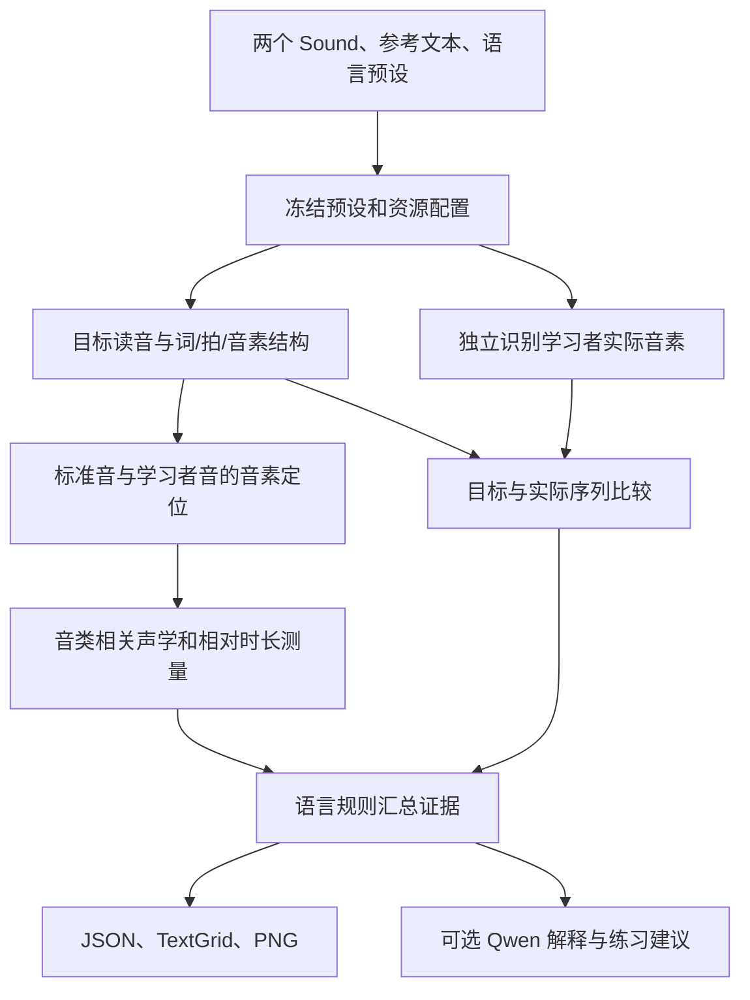

# AIPraat 多语言 AI 纠音与语言预设设计

日期：2026-10-13。状态：设计稿，尚未实施。

首批语言：日语、英语。本文定义配置面板、语言预设、分析流程和验收条件；本次只新增设计文档。

## 1. 设计目标与首版决定

用户选择标准录音、学习者录音和目标语言后，系统使用该语言匹配的读音处理、对齐资源与判断规则，输出有时间位置和证据的发音问题候选。

首版采用以下决定：

- 内置“日语（标准语）”与“英语（美式）”两套预设。发音变体是首版产品默认选择，未来可增加其他变体。
- 在现有 AI 设置中增加“纠音与语言”页面；“开始 AI 纠音”表单提供预设选择和设置入口。
- 继续使用两个已选中的完整 Sound 对象，标准音由用户提供。沿用现有 JSON、TextGrid、PNG 输出流程。
- 复用 OpenPronounce 的模块划分与音素比较思路；识别模型、读音处理和判断规则由语言预设绑定。
- MFA 负责音素定位；独立音素识别提供实际发音候选；Praat/Parselmouth 提供具体声学测量；Qwen 解释这些证据。
- 首版交付音素差异候选、相对时长和相关声学观察。两套预设初始均标为“实验性”，经过本项目验证后再逐项提升状态。
- 首版不提供未经校准的统一百分制总分。新增语言时复用程序流程，并为该语言补映射和验证材料。

首版范围不包含自动修改音频、实时录音纠正、编辑器选区接入、自动生成标准音、训练新模型，以及 GOPT/Kaldi GOP 评分模型接入。

## 2. 现有实现与接入位置

下表描述编写本文时的源码观察，不代表新功能已经实现。

| 接入点 | 当前实现 | 设计调整 |
| --- | --- | --- |
| [PraatAiControl.cpp](../sys/PraatAiControl.cpp) 的 `PraatAiControl_runAnalysis` | 调用 `run_ai_tutor.py`，使用对象列表中的选择 | 保留原生入口；语言选择在表单完成 |
| [ui.py](../ai/praat_ai/ui.py) | Tk 表单填写语言字符串、IPA 序列与统一阈值；默认语言是 `cmn` | 改为日语/英语预设选择、参考文本、读音预览；手填 IPA 放入高级区 |
| [tutor.py](../ai/praat_ai/tutor.py) | 解析请求、读取配置、计算声学差异、生成报告及模型解释 | 开始任务时解析预设并冻结配置，调用新评估模块 |
| [forced_alignment.py](../ai/praat_ai/forced_alignment.py) | MFA/CTC 对齐；不可用时按比例估算；MFA 解析主要按音素数量和次序配对 | 增加音素体系映射和区间核对；将粗略定位与可诊断区间区分 |
| [pronunciation.py](../ai/praat_ai/pronunciation.py) | 对各特征使用 DTW 和统一差异阈值 | 保留声学差异观察，增加语言规则分发和独立音素识别证据 |
| [models.py](../ai/praat_ai/models.py) | 请求、音素、声学曲线与偏差结果的数据类 | 增加预设快照、读音结构、问题类型、证据和项目完成状态 |
| [modern_settings.py](../ai/praat_ai/modern_settings.py) / [Settings.tsx](../ai/frontend/src/Settings.tsx) | 宿主读取与保存设置、前端显示分类页 | 增加配置节及“纠音与语言”分类，沿用保存与未保存提示 |
| [speech_dictionaries.py](../ai/praat_ai/speech_dictionaries.py) / [SpeechDictionaries.tsx](../ai/frontend/src/SpeechDictionaries.tsx) | 管理 MFA 词典、声学模型及 wav2vec2 本地模型目录；当前有全局活动资源 | 继续管理资源文件；纠音预设独立绑定已登记的资源，切换语言不改全局活动资源 |
| [report.py](../ai/praat_ai/report.py) | 生成偏差标注与图；没有偏差的区间写“正常” | 新流程改为“未发现问题候选”“证据不足”“未评估”等有依据的状态 |

两个现有实现细节需要在接入时处理：

1. MFA TextGrid 标签经 `unicode_escape` 解码，可能破坏非 ASCII IPA；新解析必须保留 Unicode 音素标签。
2. 当前 CTC 目标映射假定一个 PhoneSpec 对应一个 token。新映射需要支持一个语言单位对应多个模型 token，并保留返回时间区间到原词、音素和日语拍的对应关系。

## 3. 用户流程

### 3.1 配置语言

进入“AI 设置 → 纠音与语言”，选择日语或英语，查看资源状态，绑定现有资源，然后保存。普通用户使用内置预设；调整规则的用户复制预设为自定义版本。

内置预设只读。保存副本、恢复副本的默认值均只影响该预设。切换预设不删除模型或词典；删除自定义预设也不删除资源文件。

页面不因打开、保存或切换语言而下载模型、启动识别推理或调用 API。资源准备沿用现有资源管理入口；首版通过明确的操作添加本地资源。

### 3.2 开始分析

1. 在 Praat 对象列表同时选择标准音与学习者音两个 Sound。
2. 点击“开始 AI 纠音”，确认两段录音角色。
3. 选择语言预设，填写两段录音应表达的同一份文本。
4. 查看读音预览；日语必要时修正读法，英语必要时选择允许的读音变体。
5. 确认本次可完成的检查项目，点击“开始分析”。
6. 取得结果后，在学习者录音对应的 TextGrid 中查看位置，并阅读证据与练习建议。

参考文本是首版自动分析的必填项。高级用户可以提供音素序列及边界；该路径仍使用同一语言预设与报告约定。

缺少某项资源时，表单展示缺口和实际可执行项目。例如“可比较时长；音素识别模型尚未配置”。用户可明确选择“仅做声学对比”，报告使用观察性描述。

## 4. 配置面板

### 4.1 基本区

| 字段 | 初始行为 |
| --- | --- |
| 语言预设 | 日语（标准语）、英语（美式）、用户复制的自定义预设 |
| 默认分析语言 | 用户第一次选择并保存后用于后续表单；首次使用要求选择 |
| 检查项目 | 音素差异、相对时长、语言专项、声学对比；逐项显示资源是否满足 |
| 资源状态 | 文本读音、对齐模型/词典、音素识别、声学测量分别显示 |
| 解释 | 使用现有模型连接生成解释，可关闭；不属于语言声学模型选择 |
| 操作 | 保存更改、复制预设、恢复默认、管理词典与模型 |

默认发音变体显示在预设名称里。首版仅提供每种语言的一套内置变体；不展示尚未实现的方言选项。

### 4.2 高级区

高级区默认折叠，按用途展示：

- **定位资源**：优先使用 MFA，备选 CTC；绑定词典和声学模型。
- **音素识别资源**：绑定多语言或该语言专用的音素识别模型；显示实际支持的 token/单位覆盖。
- **读音规则**：可接受变体、文本读法覆盖；音素映射详情可查看。
- **判断参数**：各规则的候选阈值、最小证据要求；不再提供一个控制全部音位的“错误阈值”。
- **语言专项**：日语长音/促音/拍时长，英语音素混淆与相对时长等。

高级用户可在自定义预设中编辑映射表，保存时校验。参数修改后评估状态显示“自定义，未验证”；不继承内置预设的验证结论。

### 4.3 两种状态分别展示

| 状态轴 | 可选状态 | 含义 |
| --- | --- | --- |
| 资源可执行性 | 已就绪、部分可用、缺少资源 | 是否具备运行该项检查的材料与依赖 |
| 评估验证程度 | 实验性、已验证、自定义未验证 | 判断规则是否在对应语言和目标范围上验证 |

“已就绪”仅说明能执行，不能替代“已验证”。文件存在检查与真实推理验证分别记录；资源或规则更换后，以新配置重新验证。

示意布局：

```text
纠音与语言                          [保存更改]
语言预设   [日语（标准语） ▼]        [复制预设]
资源：部分可用                     评估：实验性

文本读音       已就绪               [管理读法]
音素定位       缺少日语 MFA 词典     [管理词典与模型]
音素识别       已配置，尚未验证
声学测量       已就绪

检查项目       音素差异 / 时长 / 长音与促音
日语音高重音   首版仅展示曲线

高级设置 ▸
```

## 5. 初始语言预设

### 5.1 英语：`en-US-general-v1`

| 项目 | 首版设计 |
| --- | --- |
| 展示名称 | 英语（美式） |
| 文本处理 | eSpeak-ng `en-us` 生成目标读音，使用匹配词典补充允许变体 |
| 对齐候选 | English MFA 声学模型，配套美式英语 MFA 音素体系词典；下载工件版本在实施验证后固定 |
| 实际音素识别 | 候选 `facebook/wav2vec2-xlsr-53-espeak-cv-ft`；与 OpenPronounce 使用的 LV60 音素模型对比后固定版本 |
| 音素差异 | 元音、辅音替换，以及增音/漏音候选；输出目标音和识别音 |
| 声学观察 | 元音 F1/F2、辅音相关频谱或时序特征；有可靠定位和有效测量时才启用 |
| 时长 | 对齐后的相对时长；考虑语速、音类和上下文，不要求与范本完全相同 |
| 首版专项范围 | 音素差异与时长；词重音仅展示辅助声学证据，不给未经校准的对错结论 |
| 初始验证状态 | 实验性 |

归一化以预设的可接受变体为依据。英语 `/r/` 的有无、元音合并和弱读等不能作为全球英语统一规则；本预设选择美式目标，其他变体以后另建预设。

OpenPronounce 的音素比较、帧概率利用与报告结构可以复用，但其总分公式及错误阈值不直接作为本项目验证结论。它目前仅英语经过作者校准，词级错误候选仍有较多误报，见[项目说明](https://github.com/Halleck45/OpenPronounce)及[评测](https://github.com/Halleck45/OpenPronounce/blob/main/benchmarks/README.md)。

### 5.2 日语：`ja-JP-standard-v1`

| 项目 | 首版设计 |
| --- | --- |
| 展示名称 | 日语（标准语） |
| 文本处理 | OpenJTalk/pyopenjtalk 前端生成读法及音素结构；汉字歧义读法可在任务中修正 |
| 对齐候选 | `japanese_mfa` 声学模型与配套词典；匹配 MFA 版本和工件版本后固定 |
| 实际音素识别 | 同一 XLSR 多语言音素模型作为候选；日语关键音素覆盖和学习者识别结果需专项验证 |
| 比较结构 | 文本/读法 → 词 → 拍 → 目标音素；保留长音、促音及撥音的信息 |
| 首版重点 | 音素差异候选、长音/促音相对时长、拍结构差异；区间不可靠时只展示观察 |
| 允许变体 | 上下文相关的无声化和鼻音实现按规则处理；保留无声化标记，不能把无 F0 自动判成漏音 |
| 音高重音 | 首版展示相对 F0 曲线，不自动判对错；后续需要目标重音信息与专项验证 |
| 初始验证状态 | 实验性 |

日语处理需要特别保留以下信息：

- 长短元音：`おばさん / おばあさん` 等对比不能在归一化时合并为同一序列。
- 促音：`きて / きって` 等对比需要保存阻塞或摩擦持续区间；不能把“小っ”机械映射成所有语境下同一个 IPA 音。
- 拍结构：`ん`、长音和促音需要保留对应单位；不要求每拍严格等长。
- 时长判断：将目标段与局部拍时长/范本相应比值比较，输出“可能偏短/偏长”。不采用统一毫秒阈值。

pyopenjtalk 的 `N`、`cl` 等内部标签、MFA 的日语音素体系、识别模型的 token 必须通过显式映射连接。原始标签也保留在结果中，不能仅按序号配对。[日语 MFA 模型卡](https://huggingface.co/MontrealCorpusTools/japanese_mfa)列出的音素包含长度和无声化差异，模型用途是对齐；[pyopenjtalk](https://github.com/r9y9/pyopenjtalk)提供读法与音素处理接口。

如果识别模型不能表达某个日语区别，音素识别项标记该区别未覆盖；可靠边界与时长测量仍可提供对应的长音/促音观察。不得通过删除长度信息制造“已支持”。

### 5.3 首版默认检查开关

| 检查 | 英语 | 日语 |
| --- | --- | --- |
| 独立识别与目标音素比较 | 默认开启，资源满足时执行 | 默认开启，日语覆盖验证通过时执行 |
| 相对时长观察 | 默认开启 | 默认开启，包含长音/促音候选 |
| 相关声学特征对比 | 默认开启，按音类选择 | 默认开启，按音类选择 |
| 自动词重音/音高重音判错 | 首版不提供 | 首版不提供 |
| 百分制综合评分 | 首版不提供 | 首版不提供 |
| Qwen 解释 | 沿用用户现有解释开关 | 沿用用户现有解释开关 |

## 6. 分析流程与证据要求



实现顺序可以串行；图中分支表示职责分离，不要求同时加载多个模型。

1. **预设解析**：确定读音转换、资源绑定、规则和实际可执行项。模型路径与版本写入任务快照。
2. **目标结构**：保留原文本、读法覆盖、允许读音、词/拍/音素索引和后端标签。
3. **定位**：标准音与学习者音分别对齐。区间要核对顺序、标签映射和持续时间。两套对齐结果的一致性可以辅助复核；首版不自动平均不一致的边界。
4. **独立识别**：学习者录音在不强制目标序列的情况下解码音素，保存 token、帧概率及音素区间。
5. **序列比较**：将实际序列与允许的目标序列匹配，识别替换、插入、删除候选；识别模型自身的不确定性进入证据。
6. **语言规则**：结合定位、帧概率和测量结果决定输出问题候选或观察项，保留决定依据。
7. **解释与交付**：结构化结果先成立，Qwen 再解释；模型解释失败时仍交付测量与标注。

| 项目 | 输出条件 | 证据不足时 |
| --- | --- | --- |
| 音素替换候选 | 独立识别与目标不同，满足该语言规则的证据要求 | 显示识别候选及不确定性，不直接标“读错” |
| 漏音/增音候选 | 序列差异与音频位置可对应；删除项通过前后音定位 | 若只能定位一个范围，报告范围；不伪造精确起止点 |
| 日语长音/促音候选 | 目标结构明确，区间可靠，相对时长支持差异 | 显示时长观察或未评估 |
| F1/F2、VOT 等观察 | 适用音类且实际工具能够可靠测量 | 显示不可测量，不使用缺失值替代正常值 |
| 粗略比例定位 | 仅用于浏览和辅助图 | 不据此发布音素级发音问题结论 |

定位质量与发音证据使用不同字段。现有 MFA 固定置信值及比例定位的 `0.25` 不能解释为“发音正确概率”；CTC 概率也不直接转换为同一套百分制分数。缺少识别模型时，可以做明确标识的声学对比，但不是完整音素错误诊断。

## 7. 配置与接口

### 7.1 配置存储

在现有 `ai_config.json` 增加 `pronunciation` 节。内置预设随应用代码保存；配置文件保存默认选择、自定义预设和资源绑定。建议内置文件放在 `ai/praat_ai/pronunciation_profiles/` 下，文件名包含稳定 ID，内容包含版本。

以下是拟议配置形状，路径与 revision 是待绑定值，不能当作已安装资源：

```json
{
  "pronunciation": {
    "schema_version": 1,
    "default_profile_id": null,
    "profiles": {
      "ja-JP-standard-v1": {
        "base_version": "1",
        "resources": {
          "text_frontend": {"backend": "openjtalk"},
          "alignment": {
            "backend": "mfa",
            "dictionary_path": "",
            "acoustic_model_path": ""
          },
          "recognition": {
            "backend": "wav2vec2_ctc",
            "model_id": "facebook/wav2vec2-xlsr-53-espeak-cv-ft",
            "revision": null,
            "local_path": ""
          }
        }
      },
      "en-US-general-v1": {
        "base_version": "1",
        "resources": {
          "text_frontend": {"backend": "espeak", "voice": "en-us"},
          "alignment": {
            "backend": "mfa",
            "dictionary_path": "",
            "acoustic_model_path": ""
          },
          "recognition": {
            "backend": "wav2vec2_ctc",
            "model_id": "facebook/wav2vec2-xlsr-53-espeak-cv-ft",
            "revision": null,
            "local_path": ""
          }
        }
      }
    },
    "custom_profiles": []
  }
}
```

每个有效预设还包含 `language`、`variant`、`phone_map_version`、`rules_version`、允许读音规则、检查开关与候选阈值。内置阈值由评估样本确定；设计阶段不填写未经验证的固定数值。

配置优先级：本次请求指定的预设/读法 → 已保存的该预设资源绑定与自定义规则 → 版本化内置默认。任务开始后冻结有效配置，后续设置修改用于新任务。

### 7.2 与现有资源管理的关系

复用现有词典和模型列表；首版以登记资源的规范化路径引用文件。保存预设时检查模型/词典音素体系是否兼容，不能只检查文件存在。

共享识别模型可以被两个预设引用。映射、规则和验证结论仍按语言分别保存。移除资源登记后，相关预设显示缺少资源，不能悄悄选择列表第一项。

旧 `alignment` 配置继续供原功能使用；用户可选择将兼容的旧资源绑定到某个预设。不能根据旧全局活动模型自动宣称日语或英语已配置完成。保存新节复用当前写入锁与字段合并方式，保留其他配置节。

### 7.3 宿主和表单接口

| 接口 | 拟议职责 |
| --- | --- |
| `settings.get` / `settings.save` | 扩展设置类型以读取/保存纠音配置 |
| `pronunciation.status` | 返回预设摘要、逐项资源状态与验证状态；不加载模型推理 |
| `pronunciation.preview` | 根据语言、文本及读法覆盖返回目标读音结构；只做文本处理 |
| `show_tutor_form` | 接受可选的预设摘要及默认选择；生成含预设 ID 的请求 |
| `run_tutor` | 读取有效预设快照、解析资源并执行分析 |

前端 `bridge.ts` 白名单、`types.ts` 与宿主 RPC 分发同时扩展。React 设置与 Tk 表单调用同一个 Python 预设服务；Tk 路径不另存一份配置。

为现有 `AnalysisRequest` 增加可选 `profile_id`、`reading_overrides` 和 `enabled_checks`。旧 JSON 请求仍走原声学对比路径，报告明确标为旧式对比；不把历史 `cmn` 请求自动改成日语或英语。新版菜单表单默认使用预设流程。

## 8. 模块安排

建议按当前 Python 包内的职责增加以下模块，不另建独立服务：

| 模块 | 职责 |
| --- | --- |
| `pronunciation_profiles.py` | 内置/自定义预设解析、资源匹配、有效配置快照与状态 |
| `pronunciation_text.py` | 英语/日语文本前端适配、读法覆盖、目标词/拍/音素结构 |
| `phone_recognition.py` | 独立 CTC 解码、实际音素区间和帧证据 |
| `pronunciation_rules.py` | 音素序列比较、证据汇总与语言规则分发 |

现有 `forced_alignment.py` 保留定位职责，`audio.py` 保留测量，`tutor.py` 保留编排，`report.py` 保留输出。OpenPronounce 通过薄适配或必要代码复用接入；是否直接依赖整个包由英语原型验证决定，日语核心数据结构由本项目掌握。

## 9. 结果与报告

每次分析记录：

- 预设 ID、版本、有效规则版本、文本和读法覆盖。
- 使用的模型、词典版本及实际完成/未完成的检查。
- 每个单位的目标音、实际候选音、位置、问题类型、证据、定位质量和评估状态。
- 工具测量数值、单位、适用范围；允许读音和归一化过程。
- 解释文字与原始结构化证据的对应关系。

新问题类型建议包括 `substitution`、`insertion`、`deletion`、`duration_short`、`duration_long`；声学差异作为 `observation`。语言专项在相应问题类型上增加规则 ID，不为每种语言重复建立报告体系。

TextGrid 首版提供目标单位层、问题候选层和证据状态层。日语可增加拍层；删除项使用点或范围提示，不能创建长度为零的 IntervalTier 区间。所有时间对应学习者 Sound；标准音的区间单独保存在 JSON。

PNG 选择有证据的特征或时长绘制，日语音高用相对基频/半音曲线并保留缺失段。缺少有效有声帧时不连接成看似完整的重音曲线。

Qwen 接收结构化问题与证据，生成通俗解释和练习建议。其解释不能提升未验证规则的状态，也不能把识别不确定项改写为已确认错误。

## 10. 实施顺序

| 阶段 | 交付物 | 完成条件 |
| --- | --- | --- |
| A：语言预设与面板 | 两套内置配置、资源绑定、读音预览、表单选择、任务快照 | 设置保存与读取一致，切换语言使用正确资源；缺少资源时状态准确 |
| B：英语完整原型 | 独立音素识别、序列比较、测量和新报告 | 真实录音能输出可复查的问题候选，完成英语人工标注评估 |
| C：日语专项原型 | 读法处理、拍结构、长度映射、长音/促音观察 | 长度信息贯穿全部模块，完成日语专项评估；报告显示未覆盖项目 |
| D：集成验收 | 原生入口、设置、模型资源及报告端到端验证 | 两套预设可从原生菜单运行，记录真实结果；验证通过的能力逐项更新状态 |

两种语言的配置与用户入口在 A 阶段一同提供。首版交付要求完成 B、C、D；不能仅把日语加入下拉框就宣称日语纠音已实现。

## 11. 验收方案

### 11.1 配置与接口

- 日语、英语绑定不同词典/映射后，切换语言确实使用相应绑定，旧全局活动资源不被改写。
- 自定义预设复制/恢复、配置保存、应用重启后读取一致；新配置不改变正在运行的任务。
- 资源缺失、音素体系不匹配和模型不覆盖目标单位时，前端与分析表单显示相同缺口。
- 旧请求仍能完成旧式声学对比，且报告不冒充新预设诊断。

### 11.2 语言与算法

- 英语：正确朗读、元音/辅音混淆、增音、漏音、允许弱读或变体、不同语速、不同说话人和录音音量。
- 日语：正确朗读、长短元音、促音有无、撥音、无声化、汉字多读法、不同语速和不同说话人。
- 通用：Unicode IPA 往返不变；多 token 映射保留边界；比例定位、缺失特征或低质量识别不会输出确定发音错误。

上述音位及规则的纯代码契约用离线测试验证；真实发音有效性使用人工标注录音验证。合成短音只验证数值与链路。

### 11.3 真实评估与产品验收

每种语言准备至少 10 位说话人的独立评估材料，包含母语者正确样本与学习者问题样本；每个优先问题类别至少 20 个标注实例。由至少两位具备该语言语音知识的标注者复核，分歧项单独记录。说话人尽可能与参数调整材料分开，避免同一人的声音同时用于调阈值和验收。

分别报告各类问题的精确率、召回率、正确样本误报率、边界误差和未评估比例。英语与日语、音素识别与时长规则分别统计，不用总体评分相关性代替错误定位质量。

初始产品发布目标是明确问题候选精确率至少 80%、正确标注单位误报率不高于 10%，同时公开召回率和样本范围。这是本设计的验证目标，不是当前系统的成绩；样本不足或不满足目标的检查继续保持“实验性/观察”。人工标注不充分时不标“已验证”。

端到端验收从 Praat 原生菜单开始，检查两种语言各自的资源、文本、实际模型推理、TextGrid 读回、PNG 与 JSON，并确认解释关闭/失败时基础结果仍交付。使用 CPU 测量耗时和峰值内存后再决定模型驻留策略。

## 12. 开源资源与实施前待确定项

| 资源 | 本设计采用方式 | 依据 |
| --- | --- | --- |
| OpenPronounce | 复用工程结构、音素比较与概率处理思路；代码 MIT | [仓库](https://github.com/Halleck45/OpenPronounce)、[音素代码](https://github.com/Halleck45/OpenPronounce/blob/main/openpronounce/phones.py) |
| wav2vec2 XLSR 音素模型 | 候选独立识别模型，Apache-2.0；逐语言验证输出覆盖 | [模型卡](https://huggingface.co/facebook/wav2vec2-xlsr-53-espeak-cv-ft)、[跨语言音素识别论文](https://arxiv.org/abs/2109.11680) |
| MFA 日语/英语资源 | 用于定位；模型卡标为 CC BY 4.0，具体词典工件另核对 | [日语模型](https://huggingface.co/MontrealCorpusTools/japanese_mfa)、[英语模型](https://huggingface.co/MontrealCorpusTools/english_mfa) |
| pyopenjtalk/OpenJTalk | 日语文本前端；包装层 MIT，原生组件和词典分别保留许可说明 | [仓库与许可说明](https://github.com/r9y9/pyopenjtalk) |
| OJAD | 后续音高重音设计的教学/研究参考；首版不下载或打包其词典 | [东京大学 OJAD](https://www.gavo.t.u-tokyo.ac.jp/ojad/) |

MFA 官方模型卡明确将发音质量评分列为适用范围外，因此本设计不以 MFA 对齐成功或其模型似然作为纠音正确性的证明。

实施前需要通过最小原型确定三项：

1. XLSR 与 LV60 模型在英语的误报表现，以及 XLSR 对日语长音/促音等目标结构的覆盖；必要时为日语换用专用音素模型。
2. 两语言配套 MFA 词典、声学模型的版本，以及运行机的 MFA 兼容性；记录固定工件后再发布预设。
3. 日语文本前端与音素模型在项目 Windows Python 环境下的安装和 CPU 推理表现。

这些验证影响具体资源选型，不改变本文确定的双语言预设、共用流程和按语言配置规则的结构。
