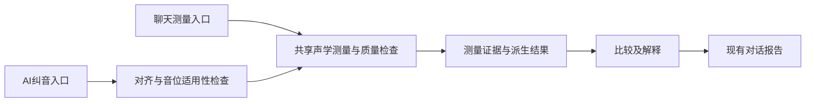

# 声学测量协议与纠音修复设计

本文规定聊天测量与双音频纠音的目标测量协议、实现职责和验收条件。文档性质为设计方案，不表示相关能力已经实现或通过准确性验收。实际行为与执行入口见[测量口径](../ai/docs/measurements.zh-CN.md)、[纠音说明](PRONUNCIATION.zh-CN.md)和[当前实现](CURRENT-IMPLEMENTATION.zh-CN.md)。

## 设计目标与依据

聊天测量与 AI 纠音复用声学测量实现；每个报告数值均能追溯到录音、对象、时间范围、算法、实际参数、有效数据与派生公式。验收分别判断执行是否成功、数值是否正确、量的定义是否一致，以及结论是否得到证据支持。

规范按以下三层管理：

| 层次 | 内容 | 维护要求 |
| --- | --- | --- |
| 科学定义 | VOT、频带能量、F0、共振峰及标注对象的含义 | 标明方法来源，不用既有代码或测试反推定义 |
| 项目测量协议 | 频带、窗函数、步长、统计口径、说话人参数、校准与比较条件 | 保存版本和本次实际设置；协议变化后检查结果可比性 |
| 工程质量参数 | 对齐筛选阈值、能量门、连续性条件及自动候选条件 | 独立记录与验证，不当作发音判错阈值或正确概率 |

方法依据沿用[本地规范参考](reference/praat-manual/README.md)：

- [Praat 频谱能量](reference/praat-manual/manual/Spectrum__Tabulate__verbose_.html)：平方幅值、频点能量及积分口径。
- [Praat 滤波自相关](reference/praat-manual/manual/pitch_analysis_by_filtered_autocorrelation.html)：语音基频算法、滤波和候选参数。
- [Praat Burg 共振峰](reference/praat-manual/manual/Sound__To_Formant__burg____.html)与 [FormantPath](reference/praat-manual/manual/Sound__To_FormantPath__burg____.html)：说话人适配及候选分析。
- [VOT 定义与测量讨论](https://pmc.ncbi.nlm.nih.gov/articles/PMC5665574/)：释放、起浊、正负 VOT 与预浊的测量含义。
- [Praat 标注](reference/praat-manual/manual/Intro_7__Annotation.html)：TextGrid 的事件点与持续区间。

## 执行关系与复用边界

目标执行关系如下：



G2P 提供目标读音，MFA 或人工标注提供定位信息。音位身份、边界质量、声学观察和语言学判断分别记录。对齐置信值不解释为发音正确概率；目标标签匹配不视为独立识别出学习者实际读音。

音位观察需要双方可靠区间、可配对音位及适用测量。比例定位、表单等分区间及无效边界只支持定位浏览。通用声学测量按用户指定的量输出；音位观察按音类选择量；语言专属判错阈值须有独立校准依据。缺少语言判据时保留描述性观察，不自动套用另一读音的规则。

共享现有 `pitch_analysis.py`、`pitch_quality.py`、`acoustic_events.py`、`pitch_events.py` 与 Praat 测量构造代码。原生 Praat 与 Parselmouth 适配路径按相同协议对照，记录实际引擎版本和可用能力。

## 测量结果与证据契约

在既有 `FeatureTrack`、音位轨迹和声学证据对象中补齐以下信息：

| 信息组 | 必须保留的内容 |
| --- | --- |
| 量的身份 | 稳定测量 ID、量名、单位、量类型、算法与协议版本 |
| 来源 | 标准音或学习者角色、录音内容标识、Praat 对象标识及来源 |
| 时间 | 原 Sound 时间域、WAV 时间轴映射、音位索引与 IPA、请求和实际分析范围 |
| 参数 | 引擎版本、实际频带、采样率、声道处理、窗函数、窗长、步长及算法参数 |
| 有效性 | 原始观察、接受与排除状态、原因、有效数据量、覆盖区间 |
| 派生关系 | 输入测量 ID、公式、统计或重采样方法、校准记录标识 |

曲线、瞬时事件和派生单值分别表达。VOT 等地标派生量直接保存为单值；F0 和共振峰保留真实观察时刻。统计量明确标识原始帧均值、中位数或 DTW 重采样后的均值，不能混用同一个含糊的“均值”名称。

缺测保存为空值并附原因，不使用零值替代。某项测量失败时，保留其他已经有效的测量。自动候选、经过质量筛查的数据、人工提供的地标及无法确定的结果保留各自状态。

报告、AI 解释、后续对话及报告守卫引用同一测量 ID。完整曲线与逐帧状态保存在附件；模型上下文使用有来源的测量摘要、地标和派生关系。报告已经使用的 DTW 派生值直接进入证据，不从原始曲线另算一个均值替代。

## 指标定义与修复要求

### 高频能量比

定义共同分析频带为 `B`，高频分界为 `f_c`：

```text
高频能量比 = E(B 中 f >= f_c 的部分) / E(B)
```

`E` 由平方幅值积分得到。单边频谱需正确处理 DC、Nyquist 及频点权重或频带边缘的积分宽度。幅值占比与能量占比使用不同量名，不能仅修改界面文字或沿用旧数值。

设计默认分界为 2000 Hz，属于项目参数。窗函数、窗长、步长及双方共同分析频带随协议保存。不同采样率或源录音带宽下，先核对可用共同频带；重采样不代表恢复原本不存在的频率信息。没有可分析高频带时保留不可用原因。

总能量大于零、高频能量为零时，结果是合法零值；总能量为零时比例无法确定。不得通过给分母添加常数，把静音变成有效的频谱比例。

能量口径启用独立算法版本。旧幅值比例的容差和异常阈值不得直接继承到新量；新量先按已定义协议输出数值和差值，判错阈值另行校准。

### 零值、负值与缺测

有效性按量定义处理，不采用“存在非零值才有效”的统一条件。

| 指标 | 零值与负值口径 |
| --- | --- |
| RMS | 零值合法；无样本与零振幅分别记录 |
| 高频能量比 | 总能量有效时零值合法；值域为 0 到 1 |
| 过零率、频谱重心 | 非静音且数据有效时，零值按定义保留；静音不能冒充有效频谱测量 |
| VOT | 负、零、正值均合法，取决于地标时间关系 |
| Lobanov 等派生值 | 负、零、正值均可合法，须有有效校准 |
| F0 与共振峰频率 | 按周期性与频率定义验证；无声或未定义的零值不视为有效频率 |
| 强度 | 合法的零或负 dB 不能因符号被排除；无能量另记状态 |

NaN、无穷值、缺少样本、算法未执行及质量检查未通过分别保留原因。数量要求取决于量类型；单个地标派生量不适用连续曲线的最低帧数条件。

### 基频

语音 F0 使用滤波自相关，保存实际提取上下限、滤波参数、步长及质量筛选参数。75–600 Hz 是项目范围预设，不称为 Praat 官方默认值；记录中的上限还须明确滤波方法的 pitch top 语义。

聊天、纠音和相对音高基线复用质量检查规则，保留能量、连续性、候选带与疑似倍频跳变等检查结果。质量筛查是工程判断，不能据此声称声调或音素身份已经确认。

统计使用同一批接受帧及其真实观察时刻。不跨缺口制造相邻数据，也不把音位边缘外的观察挪入请求范围。DTW 比较保留配对和重采样来源；无可信 F0 时输出所求量、范围和原因。

### 共振峰与说话人校准

标准音和学习者分别保存 Burg 测量参数：共振峰上限、共振峰数、有效窗长、步长与预加重。有效窗长及实际窗覆盖按 Praat 方法区分，不把不同算法中的同名“窗长”视为完全相同。

共振峰上限适配实际说话人，不再全局固定为 5500 Hz。复用 Praat FormantPath 或同协议 Burg 候选分析辅助选择，保留候选、选择依据及手动覆盖。候选范围还需受原始录音带宽约束。

参数选择使用独立、可靠标注的稳定元音材料，不按“让学习者更接近标准音”的方向选参。自动选择依据与阈值需单独验证；候选无法可靠区分时保留不确定状态。

每位说话人的校准录音和待测录音使用该说话人的同一套参数。修改参数后，依赖旧参数的校准不可继续应用。双方可以采用不同共振峰上限，但语言、校准协议、量名、单位与派生方法需经过明确的可比性检查，不能仅以参数字典完全相同或完全不同作判断。

Lobanov 校准继续由各自独立多元音材料拟合，不从待测目标音位拟合。校准标识绑定说话人、材料与测量参数。缺少有效校准时保留原始 Hz 及原因；有效 F1/F2 不因 F3 缺测而被丢弃。既有固定参数校验须同步调整，避免界面允许选参而后端仍拒绝所有非固定参数。

### VOT

```text
VOT_ms = (voicing_onset - release_burst) * 1000
```

先验证释放与起浊地标，再按原始时间相减；不重新排序。人工地标来自用户输入或可追溯的人工标注，模型估计不能升级为人工来源。

纠音使用可靠定位圈定目标塞音，并结合上下文选择覆盖闭塞、释放和起浊的搜索范围。MFA 边界用于约束搜索，不直接充当 release burst 或 voicing onset。保留整个有效搜索区间，检查起点截断、前音延续和闭塞归属，不依赖固定短窗口截断真正起点。

复用现有自动候选检测、声学回执与 `acoustic_events.py` 的验证和派生逻辑，在纠音任务中执行并接收结果。自动预浊检测的连续周期数与持续时间条件作为工程参数记录；短于候选条件不能据此判为没有预浊。

VOT 使用地标派生单值接口，不复制为两帧轨迹，也不进入曲线 DTW。每侧只需一组充分的地标证据。自动候选可以展示数值及状态，不能在比较或解释时升级为已确认地标。

预浊起点、释放、爆破后稳定周期性及清晰元音起点独立保存。爆破到清晰元音的间隔使用独立量名，不替代 VOT。没有释放、起点截断或归属无法确定时保留缺测原因与其他有效事件。

瞬时事件写入 TextGrid 点层（文件类名 `TextTier`），持续预浊和闭塞写入独立区间层。零 VOT 的重合地标共用时间点并保留事件标签。标注与报告使用同一时间轴映射。

## 比较、报告与界面

逐音位观察要求可配对且可靠定位的区间，并按音类选择适用指标。塞音 VOT、元音共振峰和擦音频谱的适用性分别检查；独立音素识别、重音或声调判定需要各自证据。

原始测量、说话人归一化结果、DTW 派生量和语言学判断分别命名。跨录音 RMS 与强度比较保留录制增益或响度归一化的已知状态，不能把原始幅度差直接解释为发音错误。

报告继续使用现有对话窗口，提供双方测量值、差值、定位与缺测信息，并保留原始附件。测量参数放在现有表单高级区域，按标准音与学习者角色配置；可选功能沿用滑块交互。配置修改、校准失效与不可比较状态直接反馈在对应位置，不增加重复确认开关或关闭确认弹窗。

参数、原始数据和完整质量细节按需展开。正文展示明确结果及影响判断的具体原因，不加入模棱两可的防御性说明。界面延续黑白灰配色、近黑文字与柔和阴影，避免不必要的二级标签和新窗口。

## 兼容与版本

新结果记录算法、测量协议与派生方法版本。既有报告及原始文件保持原样；重新计算生成新报告，不覆盖历史结果。

可识别的历史幅值比例按其实际量义读取；未记录算法或协议版本的结果保持“版本未记录”，不猜测其口径，也不直接与新能量结果混比。旧阈值不因字段名称相近自动迁移。

## 实现职责

下表表示设计的代码落点，不表示相关修复已经实现。

| 职责 | 代码落点 |
| --- | --- |
| 来源、音轨、时间轴与量类型 | [bridge.py](../ai/praat_ai/bridge.py)、[models.py](../ai/praat_ai/models.py)、[原生导出](../sys/praat_python.cpp) |
| 频谱、零值及基础声学提取 | [audio.py](../ai/praat_ai/audio.py)、[pronunciation.py](../ai/praat_ai/pronunciation.py) |
| 基频方法、观察与质量 | [pitch_analysis.py](../ai/praat_ai/pitch_analysis.py)、[pitch_quality.py](../ai/praat_ai/pitch_quality.py)、[pitch_events.py](../ai/praat_ai/pitch_events.py) |
| 说话人参数与校准一致性 | [normalization.py](../ai/praat_ai/normalization.py)、[normalization_prosody.py](../ai/praat_ai/normalization_prosody.py)、[ui.py](../ai/praat_ai/ui.py) |
| VOT 候选、验证及纠音接入 | [测量构造](../ai/praat_ai/tools/measurements.py)、[acoustic_events.py](../ai/praat_ai/acoustic_events.py)、[tutor.py](../ai/praat_ai/tutor.py) |
| 单值、轨迹与音类比较 | [pronunciation_rules.py](../ai/praat_ai/pronunciation_rules.py)、[pronunciation.py](../ai/praat_ai/pronunciation.py) |
| 文件、图像、对话与解释证据 | [report.py](../ai/praat_ai/report.py)、[tutor_report.py](../ai/praat_ai/tutor_report.py)、[report_guards.py](../ai/praat_ai/report_guards.py) |
| 表单参数与报告呈现 | [PronunciationForm.tsx](../ai/frontend/src/PronunciationForm.tsx)、[Chat.tsx](../ai/frontend/src/Chat.tsx) |

## 验收要求

### 已知信号与边界情况

| 检查 | 预期 |
| --- | --- |
| 共同频带内，低频幅值 1、高频幅值 0.5 的双频信号 | 能量比约为 0.200；测试固定窗函数与频点位置，并明确数值容差 |
| 改变整体增益 | 能量比保持不变；RMS 按增益变化 |
| 总能量有效而高频能量为零 | 合法零比例，不跳过比较 |
| 纯静音、空数据和无可用高频带 | 分别保留原因，不生成伪零比例 |
| 合法正、零、负值以及 NaN、无穷值 | 按各量定义判定，不使用统一非零条件 |
| 人工 VOT 地标构成负、零、正间隔 | 数值和符号与原始地标相减一致；显式零时刻不触发自动检测 |
| 预浊、长预浊、发声中断、前音延续与起点截断 | 保留候选与独立事件；不将无法确定的 VOT 作为确定值 |
| 非零起始时间、不同采样率及频带 | 正确映射绝对时间和可比范围；重采样不改变量义 |
| 一项失败、其他项有效 | 保留有效测量和失败原因 |

数值容差须在测试协议中预先固定。浮点误差、采样或帧分辨率、自动地标定位误差分别核对，不能用放宽数值容差掩盖地标错误。

### 原生 Praat 与入口对照

同一录音、实际参数和时间范围分别经原生 Praat、适配器、聊天入口与纠音入口执行，核对测量结果、有效数据和原因。检查真实注册与调用路径，不以底层函数存在或成功生成文件作为验收。

报告中的数值、单位、音位、双方区间和派生关系应与 JSON、TextGrid、PNG 及后续对话引用一致。比较原始帧统计和 DTW 派生量时明确其不同口径。

### 真实录音与人工复核

复用[真实材料协议](NORMALIZATION.zh-CN.md#真实录音材料协议)。参数选择与校准材料同评估材料分开；评估材料包含可追溯录音、可靠音位边界、人工声学标注和不确定项。

对 VOT 核对释放、起浊及闭塞归属；对共振峰核对轨迹、候选与说话人参数；对基频核对有效有声范围与疑似跳变。分别报告偏差、漏测、不确定比例和材料覆盖。人工复核保留标注分歧；误差门槛结合标注一致性确定，并在独立材料上验证。

合成信号与引擎对照验证数值及行为；真实录音复核验证适用性。发音判错准确率需要额外的语言判据、独立评估和明确统计口径，不由声学数值一致性替代。

### 界面与全局复查

从用户实际启动的 Praat 菜单完成分析、自动显示报告、附件查看、历史恢复和后续引用。核对标准音与学习者参数、校准状态及来源归属。

参数区和报告区检查不同窗口宽度与缩放下的可读性、组件遮挡、按钮间距和圆角；不以浏览器模拟替代实际 WebView2 验收。捕获失败与无法执行的检查明确记录。

完成针对性检查后，沿来源、测量、比较、报告和后续引用重新评估数值含义与证据一致性。发现缺陷时修复对应职责，再执行受影响验证。链路可运行不是单独的完成条件。

### 验证入口与证据

现有可复用入口包括：

- 数值与声学语义：[test_pronunciation.py](../ai/tests/test_pronunciation.py)、[test_pronunciation_rules.py](../ai/tests/test_pronunciation_rules.py)、[test_acoustic_standards.py](../ai/tests/test_acoustic_standards.py)。
- VOT 与候选：[test_acoustic_events.py](../ai/tests/test_acoustic_events.py)、[test_vot_prevoicing.py](../ai/tests/test_vot_prevoicing.py)、[test_vot_dispatch.py](../ai/tests/test_vot_dispatch.py)。
- 校准与上游对照：[test_normalization.py](../ai/tests/test_normalization.py)、[verify_normalization_upstream.py](../ai/tests/verify_normalization_upstream.py)。
- 报告与实际菜单：[test_tutor_report.py](../ai/tests/test_tutor_report.py)、[verify_python_bridge_hello.py](../ai/tests/verify_python_bridge_hello.py)、[浏览器报告检查](../ai/frontend/tests/browser/tutor-report.spec.ts)。
- 文档链接：[test_maintenance_docs.py](../ai/tests/test_maintenance_docs.py)。

实现变更时补充这些入口缺失的协议测试。运行结果与原始证据存入 `test-records/`，维护文档只保留当前规则和验证入口。当前实现、纠音、归一化说明及图示随实际落地同步改写，不将设计要求提前写成已支持能力。
