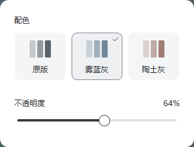

# 外观面板 UI

Windows 原生外观面板采用横向色卡，入口位于适用编辑器顶部的“外观”；有“前端”菜单的窗口中，“外观”紧随其后。实现位于 `foned/EditorAppearancePanel.cpp`，配色与窗口不透明度的功能语义见[语图外观说明](SPECTROGRAM-COMPARISON-DESIGN.zh-CN.md)，不透明度滑杆的交互与验证见[不透明度滑杆交互](APPEARANCE-SLIDER-INTERACTION-DESIGN.zh-CN.md)。



## 横向色卡布局

面板宽 328、高 248 个逻辑像素，内边距 24，圆角 14。配色区和不透明度区通过 28 像素留白分组。面板采用白色表面与柔和灰影；文字、选中态和滑杆使用中性近黑与灰色。原生面板采用浅色，不随编辑器配色切换主题。

```text
┌───────────────────────────────────┐
│  配色                             │
│                                   │
│  ┌────────┐ ┌────────┐ ┌────────┐  │
│  │ 灰色样 │ │ 蓝色样 ✓│ │ 陶色样 │  │
│  │  原版  │ │ 雾蓝灰 │ │ 陶土灰 │  │
│  └────────┘ └────────┘ └────────┘  │
│                                   │
│  不透明度                    64%  │
│  ━━━━━━━━━━━━━○───────────────     │
└───────────────────────────────────┘
```

图中线框仅表示布局；面板与背景通过阴影区分，未选色卡采用浅灰填充。

- 原版、雾蓝灰、陶土灰是同级互斥选项，每项宽 88、高 82，间距 8。每项包含三档明度色样和名称，选中项以 `#7C8289` 灰色细轮廓与勾选标识共同表达。轮廓的宽度和边缘按设备像素对齐；100%／125%／150% 缩放使用 1 个物理像素，200% 使用 2 个物理像素。
- 色样表达色调，不模拟真实声谱图。雾蓝灰采用 `#71889B`，陶土灰采用 `#9F7E71`；原版以中性灰表示既有绘制风格，不覆盖用户原有色图设置。
- 不透明度标签和当前百分比在同一行，数值右对齐并采用等宽数字。下方滑杆占满内容宽度，轨道高 4、圆形手柄标称直径 18，控件行高 32。手柄的可抓取区域至少为 24 × 32 个逻辑像素，且不小于可见圆形加描边；圆心贴近控件边缘时向仍有空间的一侧扩展，不因为贴边而被裁小。手柄圆心、半径和描边宽度对齐设备像素，圆环以像素距离计算覆盖率，四个轴向极值点保留完整描边色，其余圆弧保留抗锯齿过渡。
- 滑杆使用中性灰，下方无端点标签，控件区底部留白 24。当前百分比位于“不透明度”标题行右侧。
- 字体采用 Microsoft YaHei UI，正文 13 个逻辑像素；正文使用常规字重，字段标题使用中等字重。

## 交互语义

- 配色点击立即选择；“原版”只选择既有绘制风格，不重置不透明度或分析参数。
- 不透明度范围为 20%–100%，数值精度 1%。鼠标按指针位置连续取值，不吸附到整十；点击轨道直接定位到该位置的百分比。抓住手柄时保留按下点相对圆心的水平偏移，拖出控件或面板继续跟踪并在两端限制到 20%／100%。拖动更新百分比与轨道填充，通过 `previewOpacity` 与 `commitOpacity` 更新窗口合成，一次操作只在结束时提交一次，不改变分析缓存。
- Tab 按视觉顺序经过配色项和滑杆；配色项方向键移动焦点，空格或 Enter 选择；滑杆方向键调整 1%，PageUp／PageDown 各 10%，Home 到 20%，End 到 100%。焦点标识与配色选中标识分别呈现。
- 点击面板外部或按 Esc 关闭并保留设置；配色与不透明度按窗口独立保存。
- 面板自身保持不透明；不透明度作用于所属编辑器窗口。

## 布局与验证入口

所有尺寸按所属窗口的 DPI 缩放。面板锚定实际菜单项，限制在显示器工作区；跨 DPI 后重新打开时重建控件与字体。

色卡采用双缓冲 GDI+ 抗锯齿绘制，悬停与选中反馈不改变布局尺寸。滑杆保留 `TRACKBAR_CLASS` 的键盘、Tab 焦点与辅助功能接口，在 `WM_PAINT` 中完整重绘控件区；圆形手柄移动时，其旧位置与边缘一并清除。绘制、命中与鼠标映射共用同一组几何数据，鼠标按下、移动、松手、取消与捕获变化由面板的子类过程处理，已接管的事件不再交给原生分页或拖动。配色按钮具有实际名称，键盘焦点与选中态分别显示。

色卡填充与轮廓共用对齐后的外边界，描边中心向内偏移半个描边宽度。直线段完整覆盖物理像素，圆弧继续使用抗锯齿，避免直线与圆角的清晰度不一致。

面板圆角边缘与灰影由逐像素 alpha 表面绘制，内容窗口保持不透明并裁切在该表面的完全不透明区域内。边缘层与面板归属同一编辑器，不激活、不截获鼠标，随面板显示、关闭和销毁。

验收使用[原生验证入口](SPECTROGRAM-COMPARISON-DESIGN.zh-CN.md#构建与验证)，检查三项色卡等宽同排、间距、百分比与标签同排、全宽滑杆、键盘顺序、20%／100% 端点和关闭后保留设置。圆角边缘、100%／125%／150%／200% 显示缩放与跨显示器定位须检查实际窗口。原始证据留在 `test-records/`；浏览器预览不替代原生窗口验收。

`tools/verify-native-appearance.ps1` 的 `opacity` 与 `drag` 阶段用真实鼠标与键盘输入操作正在运行的编辑器：按整条轨道定位、按住手柄与轨道拖动、拖出控件与面板、在端点与 99%↔100% 往返，并检查捕获、失焦与 Esc 结束后的值、百分比与实际 alpha 是否一致。滑杆交互的通过条件与场景见[不透明度滑杆交互](APPEARANCE-SLIDER-INTERACTION-DESIGN.zh-CN.md#验收要求)。

`tools/verify-native-appearance-layout.ps1` 编译 `ai/tests/native_appearance_panel.cpp`，以测试专用 DPI 提供器调用面板的实际创建与绘制代码，检查 96／120／144／192 逻辑 DPI 的尺寸、间距、文字容纳和滑杆端点。检查色卡四边是否保留完整的轮廓色且无多余的混色像素，圆角是否保留抗锯齿过渡；手柄在 20%／64%／100% 位置检查四个轴向极值点的描边色。拖动过程中比较即时画面与完整重绘后的像素，检查往返拖动、配色切换、圆角混合像素及边缘层关闭与销毁，并生成 PNG。该入口检查缩放后的原生布局绘制，不模拟显示器切换或系统 DPI 通知；结果位于 `test-records/appearance-panel-native/layout.json`，同进程的事件与几何记录位于 `test-records/appearance-panel-native/drag-events.json`。
