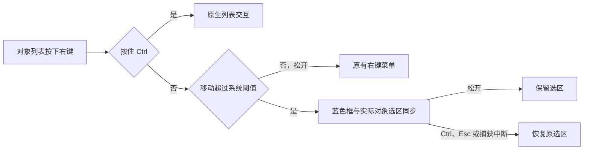

# 当前实现

使用操作见 [AI 工作台](../ai/README.zh-CN.md)，开发、构建与检查见[维护指南](../guide.md)。参数与完整接口以源码为准，本页只列职责、执行入口和关键边界。

## 桌面与数据

`sys/praat_python_wait.h` 在同步等待 Python 时保留 Win32 窗口边框交互，禁用客户端控件，并延后消息队列中的菜单、计时器和 IPC 回调；窗口移动或缩放的系统消息循环遵守同一边界。等待结束或异常退出后恢复原控件状态；同步发送的应用命令在等待期间被拒绝。

Windows 主窗口对象列表由 `sys/praat.cpp` 显式启用 `GuiList_enableRightDragSelection`。`sys/GuiList.cpp` 在 Win32 ListBox 子类中处理右键拖动，使用系统拖动阈值与高亮颜色绘制半透明矩形；命中行通过原有选择回调同步到 Praat 对象、动态菜单与 AI 上下文。Shift 扩展框选，Ctrl 交给原生列表处理且不绘制蓝色矩形；框选途中按下 Ctrl 会取消框选并恢复原选区。边缘计时器滚动时保留内容坐标起点；Esc、捕获丢失和取消消息恢复原选区。其他列表不启用此手势。

框选重绘包含列表空白区的背景擦除，随后绘制行和半透明矩形；结束或取消时立即擦除并重绘整个列表客户区。空白区不由对象行绘制覆盖，不能仅使行或无背景擦除的区域失效。

`ai/run_ai_chat.py`、`start_ai_chat.py` 经 `praat_ai/desktop_launch.py` 与 `modern_host.py` 启动 React／assistant-ui 工作台；`--legacy` 启动 Tk。Windows 宿主使用 pywebview／WebView2，从随机 loopback 端口提供 `ai/frontend/dist` 离线资产。启动与保存配置不发送模型请求。

前端入口为 `ai/frontend/src/Chat.tsx`、`store.ts`、`bridge.ts`，接口类型见 `types.ts`。聊天页通过 `window.pywebview.api.rpc(method, params)` 调用白名单；`modern_app.py` 管理会话、配置、任务与事件。事件按 `sessionId/taskId` 归属，`events.poll` 按游标返回。同一会话拒绝重叠任务，不同会话可后台执行。

设置的“上下文与输出”集中管理 Token 预算、采样参数和思考选项，云端 API 与本地模型通过页内切换分别配置。

UI 说明小字只说明功能、填写方法、当前状态和具体处理步骤，句末不加句号。模型提示词和任务 skill 按用户目标交付结论与依据；实际缺项说明所缺数据及取得方法，不要求固定的免责段落或“限制”章节。

`modern_store.py` 保存现代会话，默认库为 `ai/runtime/modern/sessions.sqlite3`；`conversations.sqlite3` 仅作只读历史来源。草稿、阅读位置与尺寸偏好由宿主持久化。`modern_organization.py` 管理分区、排序和归档，`modern_search.py` 查询正文。删除分区只解除成员关系；归档可恢复，删除现代会话会移除关联记录。侧栏单条历史会话的删除采用菜单内二次确认：首次点击后原项显示红色叉号和“确认删除？”，再次点击删除；关闭菜单取消确认。恢复和分叉复制上下文及证据，不重放 Praat 操作。

发送按钮在任务运行时显示白色方块，点击同一按钮取消当前任务；任务结束后恢复发送图标。提交请求期间显示白色方块并禁用按钮。

平滑流式文字通过 `pi/useSmoothText.ts` 按帧逐字释放，积压较多时自适应加速；新回复在任务完成后继续显示待释放文字，历史消息直接显示全文。设置关闭或系统要求减少动态效果时直接显示收到的内容；此显示层不改变宿主的回复校验和工具结果发布。

Markdown 按 remark 语法分块并复用完成块。接收状态与文字释放进度分别控制尾部预算，超预算的增长尾部完整显示为纯文本，接收和渐显结束后生成富文本。代码节点的闭合状态取自解析器围栏 token，支持脚注全文上下文及引用、列表内的 Mermaid。复制代码按节点偏移读取完整已接收代码值，不包含语言围栏或相邻正文。

`Markdown.tsx` 按块渲染：解析复用 `pi/markdown-blocks.ts` 与 ReactMarkdown 共享的同一语法，只重新解析增长中的尾部，已完成块保持组件身份不重挂载；未闭合的 Mermaid 围栏显示源码而不逐片段排队渲染；正文复制读取权威全文，显示状态与接收状态分离。组件按实际消费字段通过 `useChatSelector` 订阅（`use-sync-external-store` 官方 selector 包），未变化分支保持引用相等，空轮询、被水位过滤的重复事件与相同视图值不触发业务通知，后台会话文字增量不会重渲染当前正文或侧栏。草稿、滚动位置与阅读锚点由 `ChatStore` 的按会话视图快照管理，输入或滚动的热路径不重建侧栏会话元数据数组；防抖 `flushView` 只把累计补丁写回宿主并保留快照供恢复，本地草稿转为正式会话时迁移快照，旧记录仅在内存保留滚动、不写只读旧库。编辑器文档仍由 assistant-ui／Tiptap 管理，不建立第二套编辑器状态。

长历史阅读由 `VirtualTranscript.tsx` 承担：runtime 接收宿主的完整消息，逻辑展开范围决定读者已向上打开多少历史（首次 15 条、稳定 60 条、每次到顶增加 40 条，“显示更早”按该范围计数），实际挂载只有一批视口附近的行——上下各预留 6 条，向任一方向滚动都回收离开的行。行高经 `measureElement` 注册到共享 ResizeObserver，前插历史、行高增减与末尾增长都由引擎按消息 ID 补偿，界面不再有独立的 `scrollHeight` 差值写入或直接 `scrollTop` 修正；原生滚动与行尺寸通知的应用层派生工作共用一个 `requestAnimationFrame` 批次，缩略导航订阅同一批次并二分查询当前行，不逐帧复制全历史位置数组。缩略导航、会话内查找、回到最新与阅读位置恢复统一走该模块的定位入口，每个会话只保留当前定位请求，新的手势、会话或导航会取消旧目标；显式定位等待目标实测，并临时暂停普通末尾与尺寸补偿，避免两种校正叠加；滚轮、触控板、拖选和阅读键仍由浏览器原生处理，滚动区设置 `overflow-anchor: none`，assistant-ui 的初始化、会话切换与任务开始自动滚动全部关闭。

未展开、未挂载的行不是 DOM：轨道按可用高度把相邻标记分组，组提示会话内的消息范围，激活后提供有界的组内选择列表与翻页入口，并导航到明确消息 ID；当前消息与打开的组都以消息 ID 保存，重新分组不会更换目标，普通滚动只查找当前消息并重绘前后活动标记。挂载行用 `aria-posinset`／`aria-setsize` 报告它在整段会话中的序号与会话总数；阅读区可键盘聚焦，向上滚到已展开范围顶端即触发下一页展开。正在编辑、持有焦点或打开菜单的行，以及拖选跨过的行（受选择预算限制）作为固定行保持挂载，释放后交回引擎回收；“选择当前显示内容”与数据层“复制整个会话”是两件事。折叠状态、草稿与工具展开状态存在组件之外，行回收不会把它们重置。详见[滚动调度与长历史虚拟化设计](ai-frontend/SCROLL-VIRTUALIZATION-DESIGN.zh-CN.md)。

输入与 Markdown 分别由 `Composer.tsx`／`editor.ts` 和 `Markdown.tsx` 实现；Mermaid、KaTeX 及字体随前端离线分发。原始 HTML、外部图片和附件不作为可执行页面内容加载。布局、颜色和尺寸直接维护 `styles.css`、页面 CSS 与对应组件，不在文档重复参数表。设置、纠音、词典与 Anki 的阴影板块和设置顶部参数切换按钮共用悬停阴影；选中的切换按钮与功能板块共用常态阴影。鼠标悬停时阴影不透明度增加 3 个百分点，离开后恢复；减少动态效果偏好下即时切换。[前端来源与许可](ai-frontend/FRONTEND-SOURCES.md)保留固定来源及适配范围。

对话正文按消息窗格的可用宽度居中收缩，两侧保留布局边距；正文内边距与左侧边距共同为会话缩略导航留出空间。窗口缩放、侧栏展开与对话区宽度调整使用同一正文边界，列表、表格和代码块保持在消息区域内。

## 测量、证据与解释

`modern_execution.py` 捕获并核对 Praat 进程、对象和范围，调用 `chat.py` 与 `tools/` 包；`measures.tsv` 是表驱动参数源。`tools.py` 为兼容副本，不能用其存在证明聊天入口具备某项能力。指标定义、VOT 地标与声学测试见[测量说明](../ai/docs/measurements.zh-CN.md)。

云端执行由 `cloud_agent.py`、`cloud_runtime.py` 和 Pydantic AI 管理：L0 执行工具，L1 有限纠正，L2 解释证据，L3 按配置与用户请求观察音频，L4 一般讨论。请求和工具预算见 `escape_policy.py` 与流程配置。本地 Qwen 走 `chat.run_turn` 的独立规划循环。

`tool_guards.py` 在执行前核对对象、类型、范围、参数、脚本及命名来源；整段请求覆盖编辑器旧选区。同目标和范围的成功证据可复用；重复失败调用不会因改写默认参数而重跑。自定义脚本校验不构成操作系统沙箱。

`report_guards.py` 核对可识别的量名、数值、单位、对象、范围、引用与有限四则推导；本地正文及纠音可选解释共用 `guard_delivered_text`。报告上下文以 `E1.q1` 一类引用指向具体证据量，`{{calc:E1.q1/E2.q1*100|%}}` 由程序计算。无法核对的数值经有限纠正或遮蔽，保留原因；纠正报告不重放对象操作。已有可测音频或测量证据时，“没有音频输入”不能作为结论。

测量窗口不是音素边界，文件名不是音素身份依据，基频周期性不能独立证明清晰元音起点。音调结论需有效走向和适用的对齐、参照材料；均值不足以证明升降。守卫只能检查已实现的规则，不能认证所有语言学解释。

## 投递、材料与上下文

Windows GUI 投递使用 `%APPDATA%\Praat\Message.txt` 与定向 `WM_APP`，请求编号和开始／完成标记用于核对。`sendpraat.command_lock()` 提供跨进程锁，现代执行器另有进程内 `PRAAT_LOCK`。未采用共享锁的外部脚本不受该锁保护。

投递状态区分未发送、已发送、结果未知和阻断。结果未知时阻止普通操作；向原进程核对并取得完整有效快照后才能恢复。停止等待不能撤销 GUI Praat 已执行的脚本，也不能据此重发修改操作。独立社区脚本在批处理进程运行，不读取 GUI 对象列表或编辑器选区。

`materials.py` 保存任务音频快照及来源。精确测量、转写、模型听感和一般知识分别作为证据；模型音频能力以当前端点检测为准。`session_context.PhaseContext` 管理消息与配置身份，`modern_budget.py` 管理估算和摘要，`skill_registry.py` 追加适用技能材料。摘要不新增测量或授权。

每个模型运行阶段内，系统提示、输出 schema 与有序工具声明保持稳定，动态目标、技能和证据追加到消息尾部。`cloud_metrics.py` 记录请求指纹和供应商用量，缺失缓存字段保持未知；连接复用、缓存命中与耗时改善须分别验证。

## 双音频与安装

`ui.py` 收集双方音频、目标读音和配置，`tutor.py` 执行定位、声学比较及报告导出。通用 DTW 与英语／日语实验性音位判据有不同适用范围；未测得不能写成没有差异。MFA 取消传入子进程并终止进程树，取消不触发比例对齐回退。测量后取消保留已有结果并跳过模型解释。

纠音完成后由 `tutor_report.py` 投递到现有工作台。工作台导入独立报告会话并保存正文、原有测量证据及附件副本；Markdown 展示差异与缺测项，PNG 通过现有附件预览接口内嵌显示。恢复报告不重放分析。报告投递不创建模型任务、不改写其他聊天历史或运行状态。

[音位判据](PRONUNCIATION.zh-CN.md)、[归一化与材料](NORMALIZATION.zh-CN.md)、[安装与路径](../installer/README.zh-CN.md)分别维护专属操作和边界。`capabilities.py` 按当前解释器和 requirements 检查分析能力；`runtime_dependencies.py` 负责安装窗口中的实际加载及功能检测。

## Windows 发布

Windows MIC 同时受文件 mandatory label 与真实进程 token 约束，哈希相同不代表权限相同。`tools/NativeIntegrity.ps1` 分别检查二者；`tools/Publish-NativeExecutable.ps1` 要求发布进程至少 Medium、中转目录为 Medium 且与最终文件同卷，复制字节后核对标签和哈希，再同卷移动到最终路径；失败恢复原目标并报错。最终复制或跨卷移动不能替代该步骤。修改文件标签不改变已运行进程，须重新启动。

原生构建、桥接构建及安装器构建调用发布检查；安装目标目录仍须单独验证，构建通过不代表安装后权限必然正确。`sys/praat_python_workspace.h` 对 Low 进程使用 LocalLow 工作根，其余使用系统临时目录；这不保证所有消息文件和运行目录都可写。

检查入口为 `ai/tests/verify_native_integrity_startup.py`。机制来源：[MIC](https://learn.microsoft.com/en-us/windows/win32/secauthz/mandatory-integrity-control)、[文件安全](https://learn.microsoft.com/en-us/windows/win32/fileio/file-security-and-access-rights)、[MoveFile](https://learn.microsoft.com/en-us/windows/win32/api/winbase/nf-winbase-movefile)。
