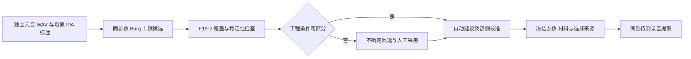

# 纠音归一化的方法与限制

归一化由 `ai/praat_ai/normalization.py` 和 `normalization_prosody.py` 实现，通过纠音表单的独立元音校准、相对音高与整段响度选项启用，默认关闭。它为[音位声学观察](PRONUNCIATION.zh-CN.md)添加派生轨迹，不覆盖音频、Sound、原始曲线或 MFA 输入，也不增加判错阈值或总分。

## 独立元音校准

共振峰采用 Lobanov z 标准化：每个说话人分别从独立多元音校准录音拟合均值和标准差，再转换其待测 F1/F2/F3。算法来源是项目内适配的 VowSpace；不从待测音位本身拟合。

协议 `balanced-monophthong-middle-40-60-three-v1` 使用以下暂定清单，不代表已验证的准确率阈值：

| 读音判据 | 单元音 |
| --- | --- |
| `ja-JP-standard-v1` | `a i ɯ e o` |
| `en-US-general-v1` | `i ɪ ɛ æ ɑ ɔ ʊ u ʌ` |

每个元音取三个有效 token；每个 token 使用其时长中间 40%–60% 区间的中位数。Burg 参数由标准音与学习者分别配置，默认预设为 5 个共振峰、上限 5500 Hz、步长 0.01 s、有效窗长 0.025 s、预加重起点 50 Hz；保留实际观察时刻，实际高斯窗覆盖约为有效窗长的两倍。高级区域支持同协议 Burg 上限候选分析与手动覆盖，不按性别或 F0 自动推断。

分别为标准说话人和学习者导入独立 WAV 及 TextGrid。TextGrid 须有唯一的 `phones`／`phonemes` IPA 区间层。说话人、语言、读音及该侧测量设置需要匹配并确认；换说话人、读音或参数后重新导入。双方可使用不同共振峰上限，校准录音与待测录音必须使用各自同一套参数。设置保存于现有配置，校准选择只保存在当前表单，提交时复制快照。

缺一方、覆盖不足、区间不可靠、零方差或设置不匹配时保持原始 Hz 观察，并报告原因。缺 F3 不阻止有效 F1/F2。派生轨迹独立命名为 `f1_lobanov_z`、`f2_lobanov_z`、`f3_lobanov_z`；未定义值不补零。

## 独立元音候选选参

在“音位判据 → 高级设置 → 独立元音自动选参”分别操作标准音和学习者。选择该说话人的独立元音 WAV 与可靠 IPA TextGrid；本次任一待测录音均不能参与选参。候选为 4500、5000、5500、6000、6500 Hz 及当前上限，其余 Burg 设置固定为该侧当前参数。候选受源录音 Nyquist 与用户声明带宽共同限制；未知源带宽保持未知，不将重采样视为恢复带宽。

协议 `independent-vowel-burg-candidates-v1` 对每个元音前三个 token 的中部 40%–60% 窗口检查 F1/F2：至少 3 个有效帧、成对覆盖至少 80%、频率顺序为 `0 < F1 < F2 < 0.95 × 上限`、相邻有效帧变化的中位数不超过 1 半音。F3 不参与候选否决。分数为逐 token 的“F1/F2 相邻变化中位数 + 10 × 缺测比例”，先对每元音三个 token 等权平均，再对元音等权平均。它是工程稳定性分数，不是共振峰准确率或发音判错阈值。

只有一个候选满足条件，或最佳与次选分差至少达到 `max(0.15, 0.25 × 次选分数)` 时，自动采用工程建议并导入该侧校准；否则保留不确定状态及当前参数，提供人工采用。无有效 F1/F2 校准或超出带宽的候选不能采用。人工可覆盖工程稳定性建议，选择来源明确记录为人工候选覆盖，不升级为自动确认。



RPC `tutor.analyze_formant_candidates` 由原生文件选择读取独立材料，`tutor.select_formant_candidate` 仅接受服务端缓存的候选 ID。选择绑定说话人对象、语言、读音和实际参数；更改对象或其余 Burg 参数后不能复用过期候选。结果保存全部候选参数、轨迹、测量 ID、质量明细、带宽约束、选择来源和校准标识。关闭 Lobanov 不删除已采用参数的选参来源。

验证入口：后端 `test_formant_selection`、`test_measurement_settings`，前端 `tests/formant-candidates.test.tsx`。真实材料准确性仍需按下述材料协议人工对照；合成信号只验证工程判据和实际提取／RPC 路径。

## 相对音高

有效有声 F0 转换为半音后减去各自基线，不拉齐音域、不消除音高动态。使用适配后的 librosa 转换函数；疑似八度跳变、缺口及低质量帧保留状态，不自动推断声调或重音。

支持两种基线：

- `utterance`：双方各自待测句的可靠有声帧。
- `independent`：双方各自提供同协议、人工确认的中性语句，不能使用待测录音本身。语言、读音、提取协议和 F0 测量范围须一致，至少有连续可靠有声帧。

派生轨迹为 `pitch_relative_st`。独立基线不等于完整说话人校准，不能据此声称说话人差异已消除。

## 整段响度

正常长度录音使用 `pyloudnorm==0.2.0` 的整段 400 ms 门控 LUFS，按恒定增益生成派生强度和 RMS。任一侧不足 400 ms 时双方统一使用明确命名的活动区间 RMS；不补静音、不缩短 LUFS 块，也不把 RMS 标成 LUFS。

轨迹名称区分 `intensity_lufs_adjusted_db`、`rms_lufs_adjusted` 和 `rms_active_relative_db`。处理不改写 WAV。目标响度及算法版本以 `normalization_prosody.py` 常量为准，LUFS 依赖还包括 requirements 约束内的 SciPy。

## 状态、依赖与验证

报告分别记录关闭、已应用、证据不足和不适用，保留所用协议、校准来源、原始及派生结果。缺失依赖时保留可用原始结果并给出“路径配置 → 配置运行库…”入口，不静默安装。

运行库安装要求见[安装说明](../installer/README.zh-CN.md)。离线测试入口包括 `test_normalization.py`、`test_normalization_prosody.py`、`test_normalization_prosody_pipeline.py`、`test_normalization_upstream_evidence.py` 和 `test_normalization_ui.py`。上游数值对照使用 `ai/tests/verify_normalization_upstream.py`。

数值一致、协议检查或合成音测试不能证明真实纠音有效性。真实录音须满足下述材料协议，并由人工核对声学观察及判断。

来源与许可证见 [VowSpace](../ai/praat_ai/_vendor/vowspace/NOTICE.md)、[librosa](../ai/praat_ai/_vendor/librosa/NOTICE.md) 和[借物表](../CREDITS.zh-CN.md)。

## 真实录音材料协议

`ai/tools/validate_normalization_materials.py` 校验本地材料，可在相同人工边界执行原始与归一化分析。它不联网、不调用模型、不修改人工标注；完整字段和模板以工具 `--help`、`--template` 及核心协议常量为准。

| 槽位 | 内容 |
| --- | --- |
| `reference_target` / `learner_target` | 两位说话人的相同目标文本和音位序列；逐音位人工判断及原因 |
| `reference_calibration` / `learner_calibration` | 各自独立多元音录音；日语五元音、美式九元音各至少三个有效 token |
| `reference_pitch_baseline` / `learner_pitch_baseline` | 仅 `independent` 模式需要；各自同协议、人工确认的中性语句与 `neutral_phrase_text` |

材料必须是真实 PCM WAV；清单路径不得越出 manifest 目录。每份录音声明匿名说话人、语言、读音、可核验来源、许可、录制日期和独立录音 ID，音频及标注以 SHA-256 绑定。合成音、TTS 和未知来源不作为真实效果证据。

人工标注使用 `normalization-human-phones-v1`，包含 `audio_sha256`、标注人、复核日期与 IPA 标签；区间有序、不重叠且位于音频内。`method` 为 `manual` 或带原对齐来源的 `human_reviewed`。未逐段复核的 MFA／ASR／等分边界不算人工标注。

双方语言、读音、量名、单位与派生协议须可比较；各说话人的校准与待测录音须采用各自同一套测量设置。材料验证器使用其模板列出的固定参数快照，未知协议不自动迁移。校准或基线录音不能同时作为任何用例的评估对象，同一录音不能归给不同说话人。工具核对 PCM 内容与声明身份，可识别改名及普通元数据改写副本；录音归属仍须人工确认。中性语句不承担元音清单覆盖要求。

```powershell
$env:PYTHONPATH = 'ai'
python ai/tools/validate_normalization_materials.py 'D:\corpus\manifest.json' --output 'D:\corpus\validation.json'
python ai/tools/validate_normalization_materials.py 'D:\corpus\manifest.json' --analyze --output 'D:\corpus\analysis.json'
```

输出路径必须尚不存在。只校验的退出码为 `0=ready`、`1=blocked`、`2=输入或 CLI 错误`。`--analyze` 关闭模型解释，保留 `prediction_raw`、`prediction`、`human_judgments`、`comparison`、`usability.states`、`pitch_scope` 与 `isolation`。不兼容或不可用时保留原因，不替换协议。

`comparison.metric=not_defined`、`accuracy=not_measured`：当前输出是描述性观察，不计算准确率或误报率。解释结果须同时说明有效数、缺失数及说话人和用例覆盖；材料就绪不等于纠音有效。检查入口为 `ai/tests/test_normalization_materials_acceptance.py`，真实材料状态以本次门禁输出为准。
