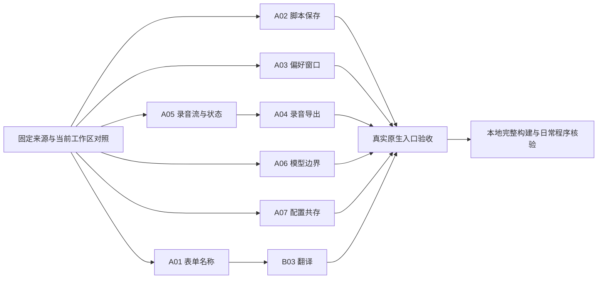

# 上游修补方案

A02、A06、A07 的条款描述当前源码实现；其余编号仍是待实施设计。当前执行入口与已有能力见[当前实现](CURRENT-IMPLEMENTATION.zh-CN.md)，构建、测试与本地程序更新见[维护指南](../guide.md)。

## 取舍

保留当前派生分支，按缺陷和调用链补入上游修复，不整体合并或重置到 `zh.5`。官方稳定版提供算法和对象格式的核对依据，中文仓库提供本地化与原生交互修复。开发分支中的独立缺陷修复可以单独采用，不因此接收同一分支的全部算法变动。

修补以用户能够保存正确数据、脚本兼容、窗口及录音操作稳定为目标。新工具栏、倍速播放、Whisper 下载窗口和对话转写工具不作为这些修复的依赖。

## 来源与版本

| 来源 | 固定提交 | 用途 |
| --- | --- | --- |
| 中文 `zh.3` | `0feb72b4d56ec47235c41edb4d50687b9847d2c9` | 核对初始派生关系，源码版本为 7.0.02 |
| 中文 `zh.4` | `6db4085c353e01d19531438908f6d84daa657096` | 核对录音、播放、快捷栏及 Whisper 引导的功能边界 |
| 中文 `zh.5` | `430ce7eb365aea4a78e5d39ecc3543a4e2898b44` | 修复候选集合；源码版本为 7.0.03beta |
| 官方 7.0.02 | `6f3da9ef1d8cce0d5684afc104d02888dfc71b25` | 稳定版源码参照 |

当前派生历史与中文 `zh.5` 的共同祖先为 `65e53ab568bfe776d8cd18a9e3b48d448321ced6`；当前项目已经包含 `zh.3` 之后的一部分 Modern 改动。版本比较须用仓库身份和完整提交号，不能使用本项目内与原作者同名的 `zh.4`、`zh.5` 标签代替原作者提交。

主要候选来源：

- [中文综合修复 fbacaa45](https://github.com/KasumiKitsune/praat-simplified-chinese/commit/fbacaa45e52d51100fed867f102d1e729ab44f22)：表单、脚本保存、偏好窗口、录音与交互。
- [中文录音电平修复 17b9c1d8](https://github.com/KasumiKitsune/praat-simplified-chinese/commit/17b9c1d82bf1e5a2d6e60e5af40d9ad1faa9bc2c)：录音中的电平刷新及录音状态重置。
- [官方 Whisper 模型读取修复 a910d21a](https://github.com/praat/praat/commit/a910d21a2705ef4cd16d91f29cdc8da1ab1a7221)：模型维度边界检查。
- [官方配置共存修复 1991fb68](https://github.com/praat/praat/commit/1991fb68229e25785b9df7e7576d9ecae9c65869)：避免 Praat 7 退出时删除 Praat 6 配置。

这些提交只作为对应行为的来源。采用前须对照当前工作区；来源提交中的其他变更不自动纳入。

## 补入清单

“优先”表示本次修补的必需范围；“随后”表示值得补入、可独立交付的兼容性修复；“条件采用”须先证实当前路径存在对应缺陷。

| 编号 | 优先级 | 更新 | 补入方式 | 主要文件 |
| --- | --- | --- | --- | --- |
| A01 | 优先 | 表单内部字段名与中文标签分离 | 适配内部名称修复，保留当前布局 | `sys/Ui.cpp` |
| A02 | 优先 | Python 编辑器保存与模板保护 | 接入现有保存/退出流程，修正上游模板方案的脏状态处理 | `sys/PythonScriptEditor.*`、`sys/praat.cpp` |
| A03 | 优先 | 偏好窗口生命周期 | 关闭时隐藏，重新打开时加载有效设置 | `sys/PreferencesDialog.cpp` |
| A04 | 优先 | 暂存录音导出正确条目及自身格式 | 以选中的 Sound 为导出来源，清理删除后的失效状态 | `foned/SoundRecorder.cpp` |
| A05 | 优先 | 录音流、声道切换和按住录音的状态安全 | 提取生命周期修复，保留现有单选暂存列表与外观 | `foned/SoundRecorder.*` |
| A06 | 优先 | Whisper 模型维度越界检查 | 只补官方模型加载边界检查 | `external/whispercpp/whisper.cpp` |
| A07 | 优先 | Praat 6/7 配置共存 | 同步退出清理条件，不改配置路径 | `sys/praat.cpp` |
| B01 | 随后 | Python 辅助命令兼容性 | 修复末尾省略号处理；按当前桥接协议核对对象名称及工作目录 | `sys/praat_python.cpp` |
| B02 | 随后 | 选区查看器的错误命中 | 提取能力判断，保留外观面板和现有编辑器布局 | `foned/FunctionEditor.cpp` |
| B03 | 随后 | 漏译与特殊字符显示 | 按真实入口补映射或绘制修复，不整体替换生成文件 | `tools/generate_translation_map.py`、`sys/GuiButton.cpp` |
| C01 | 条件采用 | 图标字体缓存的句柄回收 | 核对借用生命周期后修复，不能直接照搬缓存淘汰代码 | `sys/Gui.cpp` 及实际调用方 |
| C02 | 条件采用 | Info 文本与脚本字段兼容 | 有实际消费者受影响时连同解析兼容一起修补 | `sys/Thing.cpp`、实际解析入口 |

## 核心修补设计

### A01：表单名称与显示分离

当前 `UiForm_addField` 把翻译后的标签传给 `UiField_create`，内部名称也随之来自中文显示文字。修补后，内部字段名从原始标签派生，界面标签单独翻译；语言选择只影响显示，不改变脚本变量或 `UiForm_get*` 查找含义。

- 保留原始名称派生、参数类型、默认值和字段顺序；兼容现有英文脚本及位置参数调用。
- 内部名称处理覆盖空标签、左右配对字段、单位括号和冒号；显示文字保留正确的中文标点。
- 提取这一逻辑，不连带引入上游可缩放表单、滚动容器和行高重构。

验收使用真实表单与脚本：同一参数在中英文界面得到相同结果；零、负值和正值按字段定义分别接受或报错；缺项及错误字段名返回明确错误。覆盖普通表单、暂停表单、文件字段和配对范围字段。

### A02：Python 编辑器保存与退出

打开的 Python 编辑器登记在 `theReferencesToAllOpenPythonScriptEditors`，`v9_destroy` 在销毁时解除引用；`PythonScriptEditors_dirty ()` 报告是否有未保存的 Python 脚本，`DO_Quit` 与脚本、Notebook 的脏状态一起判断是否弹出退出对话框。

- 模板与示例经 `insertTextIntoEmptyEditorOrOpenNew` 插入：只有无文件路径、无文本且未修改的编辑器允许原位填入，已有内容、已有路径或已有修改时在新的 Python 窗口打开。原位填入和新窗口两条路径均显式设置 `dirty` 并刷新标题，确保未落盘文本参与保存与退出检查。
- `TextEditor_saveOrAskSaveAs` 复用 File --> Save 路由；未绑定文件的编辑器按其自身的 Save as... 表单询问文件名。返回 false 表示仍有未保存文本，即用户取消询问或文件写不出。
- “保存工程并退出”在对象列表非空时先写 `.praat` 工程，再依次保存 Praat 脚本、Notebook 与 Python 脚本；对象列表为空时不要求另存空工程，直接转入脚本保存。任一保存失败或取消则退出终止，其后编辑器不再处理，已写出的文件不回滚。
- 直接退出仍表示丢弃未保存内容，不改成隐式保存。`.praat` 工程只保存当前对象集合，不含脚本窗口。

验证入口 `tools/verify-native-python-editor-quit.ps1`：独立进程运行 `ai/tests/native_python_script_editor.cpp`，覆盖注册表与脏状态查询、模板与示例的填入位置、新窗口的完整内容落盘、不可写目标与另存为取消后仍保持未保存、退出对话框取消后程序继续运行且内容未丢，以及工程文件名先于脚本被询问（询问打开时脚本文件仍是改动前的内容）。退出子进程同时验证用户文本与新窗口模板均已保存。测试使用本进程私有目录里的文件与 `--no-pref-files`，不触及用户配置。

### A03：偏好窗口生命周期

当前关闭逻辑隐藏窗口后释放拥有回调对象的 C++ 实例。修补采用上游的单实例隐藏与复用：关闭不释放仍被原生控件引用的对象；再次打开先从有效配置刷新控件。

- 取消和标题栏关闭丢弃未应用的控件编辑；应用成功后更新有效配置。
- 不重复创建隐藏窗口，不重复绑定回调；窗口原生销毁时同步清理实例引用。
- 保留当前参数、输入设备选择、语言与 DPI 配置，不替换为上游完整窗口实现。

验收循环打开、编辑、取消、重新打开，再应用和重新打开；核对控件与有效配置一致、回调只触发一次、句柄不会随重复操作持续增加。语言及 DPI 改变后的显示核验使用实际原生窗口。

### A04：录音导出以选中条目为准

当前文件导出读取 `recordBuffer`、当前声道和采样率；暂存列表中的 Sound 可能来自不同录音设置。修补使已选条目的内容、声道、采样率和时长共同来自该 Sound，通过现有 `Sound_saveAsAudioFile` 导出。

本方案明确约定待实施行为：暂存列表有条目但没有有效选择时，禁用单条文件导出，不静默改选最后一条。没有暂存条目时，仅允许导出实际存在、已停止录制的有效缓冲；录制中不导出正在写入的缓冲。删除最后一条暂存录音后清理失效的样本数和导出可用状态。

保留当前单选列表和既有“发布到对象列表”的入口，不引入上游多选、右键菜单或保存全部的新交互。文件导出与发布入口均须核对来源，避免一个保存选中条目、另一个发布旧缓冲。

验收用两条内容可区分、声道或采样率不同的录音，反向选中后分别保存、重读和发布到对象列表，比较样本数、采样率、声道和样本值。覆盖无录音、无选择、删除最后一条、录制中和写入失败；不能仅比较文件是否生成。

### A05：录音流与实时状态

该项包含上游已修复的声道切换顺序、预热线程、按住录音子类化，以及录音中的电平刷新；不接收完整录音器改版。

- 先停止并关闭旧流，再修改声道、采样率或缓冲；回调停止前不重分配其正在使用的内存。新配置和缓冲准备成功后才启动新流。
- 后台预热使用主线程获取的设备和录音参数快照，不在工作线程调用可能改变共享 Melder 状态或显示 GUI 错误的函数。预热失败留给用户实际开始录音时通过正常错误路径报告。
- 录音器销毁前等待初始化线程结束并关闭流；启动失败回收半初始化句柄。缓冲分配失败不能继续用不匹配的声道数或容量录音。
- 按住录音改用每个 HWND 独立的 `SetWindowSubclass`，在销毁时移除；不再共用全局旧窗口过程，也不覆盖控件既有用户数据。松开、捕获丢失和窗口取消操作均结束按住录音状态。
- 实时电平采样与录音内容分开：录音回调不等待 UI。监测缓冲的复制可采用一次 `try_lock`，竞争时只跳过该次电平刷新；UI 只在持锁复制快照后绘图。对共享录音状态及已写样本数使用明确的同步读写，不能把新增 `quiet` 参数视为线程安全已经成立。
- 开始新录音时切换到实时电平，复位本次样本范围；不要携带旧条目选中态而继续显示旧波形。电平显示修复不附带点击绘图区切换条目的新行为。

验收包含打开后立即录音、预热未完成时关闭、连续开始/停止、单/双声道切换、设备及采样率切换、两个录音窗口、按住后移出按钮并松开、捕获被其他窗口打断。真实麦克风核验电平变化与保存音频；合成夹具验证缓冲和格式，二者不能互相替代。

### A06：Whisper 模型读取边界

`external/whispercpp/whisper.cpp` 的 `whisper_model_load` 在 `read_safe (loader, n_dims)` 之后、写入固定数组 `ne [4]` 之前检查 `0..4`，越界即报错并返回失败，走现有“读取失败”的错误路径。模型目录、Whisper 算法、线程策略和模型选择界面未变，`ops.h` 未删，whisper.cpp 未整体升级。该检查只在张量维度计数越界处生效，不代表任意损坏文件都能被拦住。

验证入口 `tools/verify-native-whisper-model-dims.ps1`：用维度计数为 `0`、`2`、`4` 和越界值的最小模型夹具，从 Praat 的 `Create SpeechRecognizer...` 实际路径加载，核对越界时错误信息可见、进程存活且未继续读张量名，范围内的夹具仍到达张量名读取。最小夹具只验证维度边界，不替代完整模型的成功加载验证；Silero 语音活动检测加载器中的同名读取点不属于本次修补。

### A07：旧配置保留

`praat_exit` 中删除 `prefsFile5` 与 `buttonsFile5` 的条件是 `Melder_appVersion () >= 8000`。判断依据是内核版本，本项目内核为 7.0.02，因此退出时只写自己的 `Preferences.txt` 与 `Buttons.txt`，保留 Praat 6 的 `Preferences5.ini` 与 `Buttons5.ini`，两者可共存。偏好目录、Message.txt、插件发现和 sendpraat 路径均未改。

验证入口 `tools/verify-native-prefs-coexistence.ps1`：在临时隔离目录放置旧配置与按钮文件，用构建产物 `Praat.exe` 分别以批处理运行和打开主窗口后关闭窗口退出，比较前后字节；两种退出都写出自身 `Preferences.txt`，关闭窗口那条还写出 `Buttons.txt`，因此确实走到脚本按钮保存分支，旧文件保持不变。测试不借用用户真实配置。

## 随后补入与条件采用

### B01：Python 辅助命令

把 `command_name.rstrip('.')` 改为只移除完整末尾 `...`，保留其他合法名称。对象 ID、UTF-8 路径、Sound 直接 PCM16 导出、导出失败终止、进程工作目录和 Python 等待期间的 GUI 保护沿用本项目实现，不整体替换 `sys/praat_python.cpp`。

对象显示名称与文件安全名分别处理，实际名称不得截断；若调整“纯名称”字段，须核对 Python 编辑器示例和消费方，不能无说明改变现有协议。POSIX 工作目录修复只在对应平台实际构建与验证时纳入，Windows 验收不能代替。

实际验证走 Python 编辑器运行和纠音菜单入口，覆盖不连续对象 ID、中文/日文名称、含空格路径、有效与无效工作目录、导出失败。现有入口为 `ai/tests/verify_python_bridge_hello.py`；按修补范围补充可观察结果，不用源码字符串断言代替运行结果。

### B02：选区查看器

对悬停、点击和拖动的命中判断统一要求编辑器确实支持 `v_hasSelectionViewer()`；内容命中同时要求查看器已显示。边界开关与内容区各自使用其真实显示状态，不能用遗留偏好让不支持该查看器的编辑器出现隐藏命中区。

保留当前外观面板、透明度、语图配色和交互。验收选择具有与不具有查看器的编辑器，在开关前后点击与拖动边界区域，确认正常选区和播放行为不被截获；不引入上游上下工具栏。

### B03：翻译与字符显示

逐项对照实际菜单和表单，将仍然缺失的词条补入 `tools/generate_translation_map.py::EXACT_MAP` 后重新生成，不整体覆盖 `sys/praat_translate.cpp` 或替换全部翻译资源。名称兼容性的验收依赖 A01。

按钮 `&&` 修复只用于已展开转义、且使用 `DT_NOPREFIX` 自绘的分支；原生快捷键语义保持原样。按钮失去鼠标捕获后的清理只处理当前存在的按下状态，不复制尚未采用的拖动进度条属性。

### C01 / C02：采用条件

图标缓存满后新建字体未被管理的问题值得修复，但上游直接淘汰并删除旧 `HFONT` 的实现须先核对调用者是否仍持有该句柄、是否仍选入 DC。确认生命周期后采用最小管理方式，不单纯把缓存从 8 改成 32 视为完成。

Info 中的英文类型、名称等标签可能属于脚本消费接口。先找到实际受影响的解析入口与支持格式，再确定恢复英文键或兼容双语；不因为上游统一键名就批量改写全部用户可见 Info 输出，也不为此新建一套数据接口。

## 暂缓的更新

| 更新 | 处理原因 |
| --- | --- |
| 整体迁入 7.0.03beta、CPP/Corpus 等算法及对象结构变化 | 与本次修复职责不同，需要量的定义、数据兼容与实际测量入口的独立评估 |
| 新上下工具栏、倍速与拖动播放进度条、WSOLA 伸缩 | 功能成组依赖较多，且与当前编辑器布局、外观交互重叠 |
| Whisper 便携目录、下载引导、联网探测 | 需要与现有路径和资源配置统一设计；不是模型边界修复的前提 |
| 将 ASR/VAD/说话人分离接入对话 | 属于新增工具能力，须另外明确对象、范围、取消、产物与证据语义 |
| 暂存录音多选、全新右键菜单、批量重命名规则 | 改变现有交互或业务语义，不作为保存正确数据的依赖 |
| 上游完整表单缩放/滚动重构、网站和跨平台发行脚本 | 不与字段名称修复捆绑；构建头文件仅按当前构建的实际缺项补入 |

## 依赖与实施边界

每个独立修复保留对应来源、实现和必要验证，便于独立回退；A04 与 A05 共用录音状态，交付时必须一起核对。A02、A07 共改 `sys/praat.cpp`，需人工保留双方行为。B01 共改 Python 桥接，B02/B03 共改现有原生控件和编辑器，不能因 Git 自动合并成功而省略行为检查。

实施前读取未提交改动，避免覆盖现有工作；不为同步上游修改本地同名标签，不执行覆盖工作区的 rebase/reset。若需要隔离构建，使用明确快照，不能把只含 HEAD 的测试结果当作包含未提交代码的验收。

## 验收与交付

- `tools/verify-native-python-editor-quit.ps1` 与 `tools/verify-native-whisper-model-dims.ps1` 将 `OutputDirectory` 作为输出根目录，每次创建独立的 `run-<GUID>` 子目录；已有文件与历次结果均保留。`tools/verify-native-output-isolation.ps1` 对两个真实入口分别连续运行两次，核对既有文件和上一轮结果未变。
- 先为拟补入的缺陷构造能观察错误结果的用例，再在修复后从相同入口复验。自动化覆盖表单取值、文件内容、对象身份与错误结果；麦克风、鼠标和缩放体验另做实际检查。
- 原生测试夹具采用项目已有 `ai/tests/native_*.cpp` 与 `tools/verify-native-*.ps1` 的独立进程方式，按需要增加用例，不为每个源文件建立重复测试。旧测试记录不视为当前通过。
- 表单和窗口验收包含中英文、100%/125%/150%/200% 缩放、最小窗口及跨屏缩放；检查键盘焦点、Esc/Enter、遮挡、控件间距、圆角和细描边。沿用黑白灰与现有外观，不添加解释性小字或重新设计整套视觉。
- A04/A05 必须验证保存后重新读取的音频。A02、A06、A07 的上述要求已经由各自验证入口覆盖磁盘内容、取消后的编辑器内容与模型创建入口的进程存活，见对应小节。
- 复用 `tools/verify-native-list-selection.ps1`、`tools/verify-native-appearance.ps1` 和 `tools/verify-native-appearance-layout.ps1`，按触及范围验证对象列表与编辑器现有能力；Python 桥接复用 `ai/tests/verify_python_bridge_hello.py`。这些入口不替代新增缺陷用例。
- 原生完整构建后先验证测试程序。实施进入日常本地程序更新时，通过 `tools/Publish-NativeExecutable.ps1` 更新根目录 `Praat.exe`，核对来源与目标哈希，保存现有工作并重启后复验。测试目录构建成功不等于日常程序已更新。
- 不因原生修补运行真实云端模型请求；只有实际改变对应对话或纠音执行路径时才扩大验证到该路径。
- 测试证据保存在 `test-records/`；维护文档只保留当前行为和验证入口，不积累一次性通过数或实施流水。修复落地后用实际实现改写本文件中的对应设计，删除已被替代的条款。

## 实现边界

当前源码实现 A02、A06、A07；A01、A03、A04、A05 与 B、C 各项仍是待实施设计。实际验证入口见各条款，原始运行材料留在 `test-records/`，不作为以后版本通过的保证。

内核版本为 7.0.02；安装包的 8.x 产品版本号不改变 A07 的内核版本判断。旧配置删除分支的验证须使用对应内核版本，不能由 Praat 7 保留旧文件的用例代替。

退出对话框按钮仍写作 `Save Project (.praat)`，其实际行为包括保存未保存脚本。日常程序使用根目录 `Praat.exe`，更新与重启按维护指南执行。
