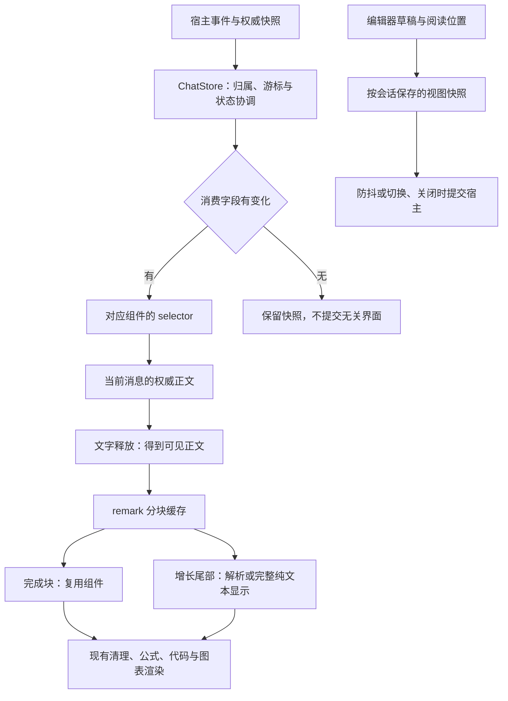

# 前端流畅性设计

状态：组件稳定、增量分块、字段订阅与按会话视图快照已接入现代工作台。本文定义当前结构和验收要求，不代表已完成全部真实桌面性能验收。实现与来源见[前端来源](FRONTEND-SOURCES.md)，运行入口和实现边界见[当前实现](../CURRENT-IMPLEMENTATION.zh-CN.md)。

## 目标与范围

本设计覆盖三个相互衔接的职责：保持 Markdown 子组件身份稳定、只重新解析增长中的 Markdown 尾部、按实际消费字段订阅状态。目标是在回复持续增长时减少重复挂载、重复解析和无关组件提交，使输入、滚动和正文显示能够同时响应。

适用入口为 `ai/run_ai_chat.py` 启动的 React／assistant-ui／pywebview／WebView2 工作台。正文经 `Chat.tsx`、`Markdown.tsx` 和 `pi/useSmoothText.ts` 显示；宿主事件经 `bridge.ts`、`store.ts` 进入前端。

本设计不包含轮询频率调整、历史列表虚拟化、Praat 原生绘制优化、编辑器替换或状态框架迁移。滚动事件协调和长历史移动窗口另见[滚动调度与长历史虚拟化设计](SCROLL-VIRTUALIZATION-DESIGN.zh-CN.md)。声学计算、工具结果发布和宿主 RPC 的权威性继续由既有执行链路负责。

## 当前代码与重复工作

| 入口 | 当前行为 | 本设计处理的问题 |
| --- | --- | --- |
| [Markdown.tsx](../../ai/frontend/src/Markdown.tsx) | 固定组件映射和块级 memo，分离接收状态与文字释放进度 | 完成块复用，接收中的超预算尾部显示完整纯文本 |
| [pi/useSmoothText.ts](../../ai/frontend/src/pi/useSmoothText.ts) | 按帧释放文字；新回复可在任务结束后继续渐显 | 帧频限制不限制单次 Markdown 处理的工作量 |
| [store.ts](../../ai/frontend/src/store.ts) | 使用字段 selector；抑制空轮询通知；视图快照与保存补丁分开 | 输入和滚动不重建会话元数据数组，无变化时不通知 |
| [Chat.tsx](../../ai/frontend/src/Chat.tsx) | 对接 assistant-ui、阅读锚点、草稿、历史恢复和任务状态 | 优化必须保留这些入口的行为，不能只替换独立渲染组件 |

以上是源码层面的工作量分析，不是实际桌面的帧率或输入延迟结论。

## 来源选择

本设计使用固定提交评估代码，提交标识不代表自动跟随上游更新。

| 来源 | 固定提交 | 许可 | 本设计用途 |
| --- | --- | --- | --- |
| PI-Desktop | [9f313c8f855ef6f8311622ad63dd7e6583cef2d7](https://github.com/vastsa/PI-Desktop/tree/9f313c8f855ef6f8311622ad63dd7e6583cef2d7) | LGPL-3.0 | 组件映射、块级 memo、remark 分块及适用测试的代码来源 |
| dsh-TUI | [3ffbf24628fc850e5dd3406798e34ca6ee16b924](https://github.com/ccch1mneyyy/dsh-TUI/tree/3ffbf24628fc850e5dd3406798e34ca6ee16b924) | MIT | 窄订阅和无变化不通知的设计参考，以及稳定节点验收思路 |
| React 官方 selector 包 | 本地 lockfile 中的 `use-sync-external-store@1.7.0` | MIT | 为现有 ChatStore 提供 `useSyncExternalStoreWithSelector` |

### 组件稳定与 Markdown：选择 PI-Desktop

PI 的 [Markdown.tsx](https://github.com/vastsa/PI-Desktop/blob/9f313c8f855ef6f8311622ad63dd7e6583cef2d7/apps/desktop/src/components/Markdown.tsx) 使用固定组件映射和块级 memo；[markdown-blocks.ts](https://github.com/vastsa/PI-Desktop/blob/9f313c8f855ef6f8311622ad63dd7e6583cef2d7/apps/desktop/src/lib/markdown-blocks.ts) 使用与 ReactMarkdown 对齐的 remark 语法，适合本项目已有的 GFM、数学公式和清理链路。

dsh 的 [StreamingMarkdown.tsx](https://github.com/ccch1mneyyy/dsh-TUI/blob/3ffbf24628fc850e5dd3406798e34ca6ee16b924/src/components/StreamingMarkdown.tsx) 同样保留完成块，但使用 marked，并包含终端换行、ANSI 布局、节点间距和尾部裁剪逻辑。将其直接用于本项目会引入另一套分块语法，并需要改写终端输出结构。因此，正文代码取 PI 的必要片段；dsh 的[稳定节点验证](https://github.com/ccch1mneyyy/dsh-TUI/blob/3ffbf24628fc850e5dd3406798e34ca6ee16b924/scripts/verify-streaming-markdown-blocks.tsx)作为 DOM 行为测试的参考。

保留本项目的 highlight.js、KaTeX、Mermaid、宿主链接处理和安全规则。PI 的 Shiki、文件菜单、远程图片和宿主插件体系不属于搬用范围。

### 状态订阅：选择轻量适配

PI 的 [app-store.ts](https://github.com/vastsa/PI-Desktop/blob/9f313c8f855ef6f8311622ad63dd7e6583cef2d7/apps/desktop/src/stores/app-store.ts) 依赖 Zustand 及其应用状态结构。dsh 的 [session-projection-store.ts](https://github.com/ccch1mneyyy/dsh-TUI/blob/3ffbf24628fc850e5dd3406798e34ca6ee16b924/src/dsh-adapter/session-projection-store.ts) 展示了按关注会话读取值、值不变时不通知的较小订阅边界，适合参考。

dsh 的引用比较建立在进程内共享对象上；本项目的 RPC 返回反序列化对象，不能以远端对象身份判断内容是否变化。保留现有 ChatStore 的游标、水位、任务隔离和快照协调，由本地状态保留未变化分支的引用，再通过官方 selector 包比较消费结果。该包当前是间接依赖，设计要求将其声明为直接依赖，并同步类型声明和 lockfile。

## 目标数据流

selector 限制状态变化的消费者；完成块缓存限制正文变化的处理范围。两者分别覆盖不同的重复工作。

## Markdown 渲染契约

### 稳定组件与图表生命周期

`pre`、链接、图片及其组件映射定义为稳定引用。`rpc` 和错误回调通过稳定 props 或仅依赖这些值的 memo 上下文提供；增长正文不得使服务上下文每帧换新。插件数组和固定选项也保持稳定。

在普通追加且完成块边界不变时，代码块和 Mermaid 图表保留组件实例。接收或渐显中的 Mermaid 围栏尚未闭合时显示源码或等待状态，不对每个残缺片段排队渲染。正文显示结束后，格式错误仍由图表错误提示和源码入口承接。队列中的已失效任务在执行重计算前检查有效性。

`markdown-code.ts` 使用 remark 解析器的围栏 token 为每个代码节点标记闭合状态；该元数据经过显式清理规则传给渲染组件，不改变 Markdown 语法。判断针对代码节点，因此脚注导致全文单块时，以及代码位于列表或引用内时，闭合图表仍可渲染。

正文权威替换、真实内容变化或全文引用上下文改变时，允许必要的缓存失效和重建；不得用“节点永不改变”阻止正确内容更新。

### 分块与语法一致性

适配 PI 的 `parseMarkdownBlocks`、`advanceMarkdownBlocks` 和缓存结构。分块器与 ReactMarkdown 共用 GFM、数学语法配置；显式解析依赖的版本与 lockfile 必须使两者解析语法一致。不得另写按空行或正则猜测边界的分块器。

每个块保留原始来源片段及起始偏移，片段连接后严格等于输入。保留 CRLF、前导缩进和块间空白。普通追加只重新处理尚未稳定的尾部，完成块通过稳定内容和块级 memo 复用。

引用式链接定义和脚注具有全文作用域，沿用 PI 的完整上下文处理，包括定义晚于引用到达的情况。此类正文可以放弃块级复用；普通追加的低重复工作要求不适用于该分支。正文不再以已有内容为前缀时，按权威替换重建缓存。

流式尾部预算以 PI 的 `32 * 1024` 个 UTF-16 代码单元为适配初值，属于内部渲染参数，不是宿主回复长度限制。超出预算的增长尾部保留完整文字并采用纯文本呈现，不裁掉正文或复制内容；显示结束后按完整上下文生成最终富文本。全文引用分支的处理成本须单独测量，不能宣称所有输入都具有恒定单帧成本。

### 接收状态与显示状态

任务是否仍接收内容，与可见文字是否追上权威正文分别判断。任务完成但文字仍在释放时，继续使用增长内容的处理路径；释放结束后才完成最终渲染。

保留以下显示语义：新回复可以从空文本渐显；任务完成不强制跳到全文；历史消息直接显示；权威修正文案直接生效；设置关闭或系统减少动态效果时跳过文字动画。取消按权威文本结束显示，不保留失效动画或跨会话缓存。

链接仍经宿主打开，原始 HTML、外部图片与可执行附件限制继续生效。复制消息读取权威完整正文；复制代码在点击时按节点来源偏移解析权威正文，提取该节点的代码值，排除语言围栏和相邻正文。此解析不进入逐帧显示路径，渐显未结束时仍能复制该节点的完整已接收代码。

## 状态订阅与视图数据契约

### 按消费字段订阅

ChatStore 使用 `useSyncExternalStoreWithSelector` 暴露选择订阅。原始快照在无变化时保持引用稳定；selector 返回对象或数组时，使用稳定投影或针对消费字段的比较，避免每次读取都分配一个必然不等的新结果。

| 消费方 | 需要的变化 |
| --- | --- |
| App 外壳 | 启动与连接状态、错误、设置导航、当前会话标识及所需元数据 |
| Chat 正文 | 当前会话消息、加载状态、相关任务状态和影响正文的设置 |
| Composer／ComposerStatus | 当前会话可编辑性、提交与运行状态、模型配置；草稿继续从编辑器运行时读取 |
| 侧栏、SessionRow、悬停预览 | 会话元数据、排序、分区及确实展示的预览字段 |
| 设置、分区管理、尺寸偏好 | 各自使用的配置、组织状态或偏好值 |

订阅边界同时检查父组件传递的 props 和 Context。子组件 selector 不变时，父组件仍传入全新会话对象或回调，也可能继续触发更新。

### 无变化通知

空事件批次、被水位过滤的重复事件以及相同视图值不触发业务状态通知。游标仍正常前进。连接状态、错误、模型设置导航和重置事件是独立的真实变化，不能被空批次快速路径吞掉。

保留 `sessionId/taskId` 归属检查、权威快照水位、请求期间事件重放和最终正文协调。无变化判断不使用整棵状态的深比较或 JSON 序列化。

### 草稿与阅读位置

草稿、滚动位置、阅读锚点由按会话保留的视图快照管理，热路径不重建侧栏会话元数据数组。编辑器文档仍由 assistant-ui／Tiptap 管理，不建立第二套编辑器状态。

当前视图快照与待提交的保存补丁分开管理：`flushView` 可以消费待保存补丁，但不能删除仍需恢复的当前草稿和阅读位置。读取接口对已加载宿主值与本地较新值提供一致合并结果。

必须覆盖这些消费者和生命周期：

- 初始化、会话加载、切换、刷新和事件重置均读取本地较新的视图值。
- 会话切换与页面关闭沿用立即保存入口，普通修改沿用防抖；保存请求期间的新修改不得被旧请求完成覆盖。
- 本地草稿持久化为正式会话时迁移视图快照；空会话判定使用当前草稿，保留既有不落库和退出删除策略。
- 提交失败恢复草稿，成功提交按现有规则清空；附件仍按会话隔离。
- 删除会话时清理对应缓存和保存任务；旧记录的阅读位置可保留在内存，不能写入只读旧库。
- ComposerStatus 继续接收当前输入并更新下一回合用量估算，收窄订阅不能冻结估算或模型切换反馈。

## 适配与分发边界

| 文件或目录 | 设计职责 |
| --- | --- |
| `ai/frontend/src/Markdown.tsx` | 稳定组件映射、块级渲染、服务上下文和图表生命周期 |
| `ai/frontend/src/pi/markdown-blocks.ts`、`markdown-code.ts` | PI 分块核心、本地代码节点元数据与按需复制解析；不引入其宿主运行时 |
| `ai/frontend/src/pi/useSmoothText.ts`、`Chat.tsx` | 连接可见正文、接收状态与释放完成状态 |
| `ai/frontend/src/store.ts` | selector、无变化快照、视图快照及持久化协调 |
| App、Composer、ComposerStatus、侧栏、设置、Panes 等消费者 | 使用各自需要的订阅；检查 props 与 Context 传播 |
| `ai/frontend/package.json`、`package-lock.json` | 显式 selector／解析依赖及类型，保持依赖解析一致 |
| `ai/frontend/tests/`、`ai/tests/` | 分块语义、节点稳定性、状态隔离与真实桌面验收 |
| `ai/third_party/pi-desktop/` | 固定原文件、许可和明确适配范围 |

复制或提取 PI 代码时，保存固定提交的原文件，适配文件明确标识来源与 LGPL-3.0 许可。dsh 仅作为设计参考时如实记载；若复制其测试或代码片段，保存对应 MIT 声明和来源。官方 selector 包通过依赖许可流程分发。

实现后的 [FRONTEND-SOURCES.md](FRONTEND-SOURCES.md)、PI NOTICE 和[当前实现](../CURRENT-IMPLEMENTATION.zh-CN.md)只记录实际采用的结构与来源。现有构建脚本负责生成 `public`、`dist` 中的许可材料、适配源码和重建输入；不能只更新其中一个源码镜像。

## 验收要求

### 行为和工作量

| 场景 | 通过条件 |
| --- | --- |
| 完成代码块、图表之后持续追加普通正文 | 完成块不重新挂载、解析；不重复调用图表渲染器 |
| 列表、表格、围栏、数学公式、CRLF、中文和 emoji 分批到达 | 最终内容、结构和完整渲染一致，无错分块、重复或丢字 |
| 引用定义、脚注晚到；正文权威替换 | 完整上下文正确更新；旧缓存不会遮挡新内容 |
| 超预算未闭合尾部 | 正文、源码及复制内容完整；最终显示正确 |
| 回复与完成事件同批到达；取消；重新打开历史 | 保留显示语义，不残留失效动画 |
| 已连接且无导航、错误变化的空轮询 | 业务状态通知和消费组件提交均为零，游标处理仍正确 |
| 后台会话文字增量 | 当前正文及无相关展示字段变化的组件不提交 |
| 当前会话连续输入和滚动 | 无相关元数据变化的侧栏不提交；输入、用量估算和阅读位置正常 |
| 会话切换、刷新、失败提交、保存并发、本地 ID 转正式 ID | 草稿、附件、阅读位置和保存顺序正确 |
| 重复事件、快照水位、事件重置、连接恢复、设置导航 | 归属、最终正文和可见状态正确，无遗漏通知 |

PI 的 [markdown-blocks 测试](https://github.com/vastsa/PI-Desktop/blob/9f313c8f855ef6f8311622ad63dd7e6583cef2d7/apps/desktop/test/markdown-blocks.test.mjs)可提取适用案例；dsh 的节点复用断言改写为本项目 DOM 测试。断言依据最终语义和实际工作量，不以实现分支本身作为正确性标准。

### 验证入口与证据

现有单元测试入口包括 `tests/bridge-store.test.ts`、`tests/organization-store.test.ts`、`tests/smooth-text.test.tsx` 和 `tests/composer-status.test.tsx`；浏览器入口包括 `smooth-stream.spec.ts`、`ui.spec.ts`、`search-scroll.spec.ts`、`minimap.spec.ts` 和 `composer-status.spec.ts`。新增的 Markdown 和 selector 测试应接入现有 Vitest／Playwright 配置，不建立独立测试框架。

前端构建与测试从 `ai/frontend` 执行 `npm run build`、`npm test` 和 `npm run test:ui -- <相关测试文件>`。真实桌面沿用 `ai/tests/verify_smooth_stream_desktop.py` 的生产资产与 WebView2 验证入口，补充长回复、公式／图表、中文输入和滚动同时进行的场景。

在相同输入、窗口尺寸、动态效果偏好和构建条件下比较优化前后结果。采样至少覆盖普通短回复、多块长回复、单个超长未闭合块、全文引用、多个后台任务以及空闲轮询。记录组件挂载次数、分块解析次数与输入长度、组件提交次数、帧间隔分布、超过 50ms 的长任务，以及输入事件至下一次绘制机会的延迟。自动化延迟是测量代理，实际中文输入法交互还需桌面验收。

普通追加场景以完成块无重复工作和无关组件无提交作为确定性要求；耗时指标报告同条件前后数值，不能用终端性能、动画采样次数或单个合成用例推导实际桌面帧率。格式与内容正确、阅读位置稳定是性能验收的前提。

原始样本、环境参数、计数和追踪证据保存在 `test-records/frontend/`。本文和当前实现说明不累积某台机器的通过数、性能结论或实施过程记录。
