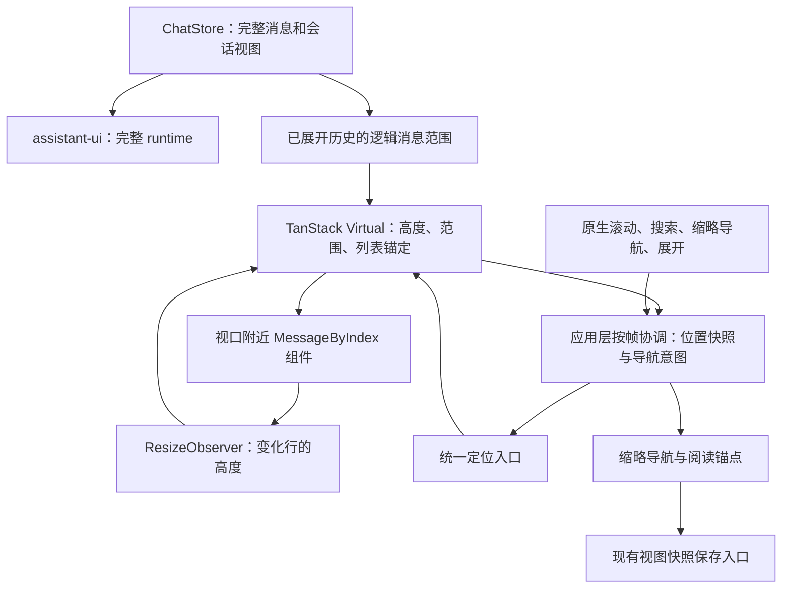

# 滚动调度与长历史虚拟化设计

状态：已实施。本文覆盖滚动事件合并、布局测量协调，以及随视口移动的消息挂载窗口；`ai/frontend/src/VirtualTranscript.tsx`、`transcript-window.ts`、`MinimapRail.tsx`／`minimap.ts`、`SearchBar.tsx` 和 `Chat.tsx` 按本文职责运行。现有组件稳定、增量 Markdown 和状态订阅见[前端流畅性设计](FLUIDITY-DESIGN.zh-CN.md)；本文描述当前架构与验收契约，不代替实测数据。

## 目标与实际入口

适用入口为 `ai/run_ai_chat.py` 启动的 React／assistant-ui／pywebview／WebView2 工作台。优化对象是聊天正文、缩略导航、会话内查找和阅读位置恢复；Praat 原生绘制、宿主轮询频率及历史 RPC 分页不在范围内。

两个目标共同使用一份消息位置模型：滚动时减少重复读取布局和重复提交；浏览长历史时只挂载视口附近的消息，向任一方向滚动都回收远处的消息组件。输入、流式回复、展开工具记录和历史定位必须继续正常工作。

虚拟化只限制消息组件及其 DOM。宿主当前返回完整历史，原始消息、索引和高度元数据仍随消息总数增长；单条特别长的消息仍可能有大量 Markdown 节点。不能据此宣称完整会话加载时间、总内存或单条正文渲染成本已经固定。

## 结构与实际入口

| 入口 | 当前行为 |
| --- | --- |
| [Chat.tsx](../../ai/frontend/src/Chat.tsx) | 把完整消息集合交给 assistant-ui runtime，只把逻辑展开范围与固定行交给虚拟列表；行外壳以持久消息 ID 为 key，按完整 runtime 索引调用 `ThreadPrimitive.MessageByIndex`；所有导航与恢复都走 `TranscriptHandle`，不再有第二条滚动写入路径 |
| [VirtualTranscript.tsx](../../ai/frontend/src/VirtualTranscript.tsx) | TanStack Virtual 引擎与按帧协调器：一个 `requestAnimationFrame` 批次读取锚点、判断末尾跟随、执行到顶展开；行高只来自 `measureElement` 的 ResizeObserver；显式导航带代次令牌，统一从 `position` 进入；列表原点由 `scrollMargin` 表达 |
| [transcript-window.ts](../../ai/frontend/src/transcript-window.ts) | 逻辑展开策略（首次 15 条、稳定 60 条、每次增加 40 条）、内容坐标阅读锚点与选择预算的纯计算；`mounted` 是可滚动范围，不是 DOM 行数 |
| [MinimapRail.tsx](../../ai/frontend/src/MinimapRail.tsx)／[minimap.ts](../../ai/frontend/src/minimap.ts) | 位置来自引擎元数据；标记按轨道容量分组，普通滚动只定位当前消息并重绘前后活动标记；组内提供有界选择列表后按消息 ID 导航 |
| [SearchBar.tsx](../../ai/frontend/src/SearchBar.tsx)／[search.ts](../../ai/frontend/src/search.ts) | 已挂载区域用 DOM Range 与 CSS Highlights 计实际命中，未挂载消息只提供“可能匹配”候选并先展开逻辑范围再定位 |
| [store.ts](../../ai/frontend/src/store.ts) | 按会话保存视图快照，防抖提交，切换和关闭时刷新；滚动热路径不触发全局订阅 |
| [styles.css](../../ai/frontend/src/styles.css) `.transcript` | `overflow-anchor: none` 关闭浏览器自动锚定，原生滚动手势保留 |

这些是源码结构结论；实测的挂载数、批次耗时与长任务数据见[前端验收记录](../../test-records/frontend/)。

## 来源选择与搬用边界

先比较 PI-Desktop 与 dsh-TUI，再选择适合浏览器的实现。固定引用用于明确评估对象，不自动跟随上游更新。

| 来源 | 固定版本与许可 | 适配判断 | 本设计采用的部分 |
| --- | --- | --- | --- |
| PI-Desktop | [9f313c8f855ef6f8311622ad63dd7e6583cef2d7](https://github.com/vastsa/PI-Desktop/tree/9f313c8f855ef6f8311622ad63dd7e6583cef2d7)，LGPL-3.0 | 同为 React 桌面界面；其历史窗口也是从尾部向上扩展，不能直接提供移动虚拟窗口 | 阅读锚点、会话恢复和展开交互的语义，复用本地已经接入的必要代码 |
| dsh-TUI | [3ffbf24628fc850e5dd3406798e34ca6ee16b924](https://github.com/ccch1mneyyy/dsh-TUI/tree/3ffbf24628fc850e5dd3406798e34ca6ee16b924)，MIT | 有滚动通知合并、累计高度和可视范围裁剪，但依赖 Ink／Yoga、终端行高和 scrollback | 参考事件合并、视口加预留区和稳定锚点思路；不搬终端滚轮积分、16ms 定时器或终端布局代码 |
| TanStack Virtual | [@tanstack/react-virtual@3.14.22](https://github.com/TanStack/virtual/releases/tag/%40tanstack/react-virtual%403.14.22)，MIT | 提供 React 动态高度虚拟列表、稳定键、前插锚定及流式末尾跟随，符合浏览器滚动模型 | 作为虚拟列表引擎候选，固定依赖与 lockfile；用实际 assistant-ui／WebView2 入口验证适配后接入 |

结论：阅读交互优先复用 PI 的现有适配；应用层事件合并参考 dsh；消息范围、动态高度和列表补偿采用 TanStack Virtual。两份参考仓库都不适合整套搬来替换浏览器滚动。

具体依据：PI 的 [transcript-window.ts](https://github.com/vastsa/PI-Desktop/blob/9f313c8f855ef6f8311622ad63dd7e6583cef2d7/apps/desktop/src/lib/transcript-window.ts)；dsh 的 [ScrollBox.tsx](https://github.com/ccch1mneyyy/dsh-TUI/blob/3ffbf24628fc850e5dd3406798e34ca6ee16b924/src/ink/components/ScrollBox.tsx) 与 [MessageList.tsx](https://github.com/ccch1mneyyy/dsh-TUI/blob/3ffbf24628fc850e5dd3406798e34ca6ee16b924/src/components/MessageList.tsx)；TanStack 的[聊天模式说明](https://github.com/TanStack/virtual/blob/%40tanstack%2Freact-virtual%403.14.22/docs/chat.md)、[API 契约](https://github.com/TanStack/virtual/blob/%40tanstack%2Freact-virtual%403.14.22/docs/api/virtualizer.md)及 [React 实现](https://github.com/TanStack/virtual/blob/%40tanstack%2Freact-virtual%403.14.22/packages/react-virtual/src/index.tsx)。

本地 PI 阅读代码的来源头当前标注 `0d47d26769ecbeca1c3ab56fa83b58a91de8190e`，继续保留真实来源。已接入的依赖、固定版本与许可记录在[前端来源与许可](FRONTEND-SOURCES.md)，许可文本由 `npm run prebuild` 生成的 `public/THIRD-PARTY-NOTICES.txt` 随发行包提供。

## 共同架构

区分三种集合：完整消息由宿主数据决定；逻辑范围表示用户已经展开的历史，保留“显示更早”入口；物理挂载范围由视口决定。展开更多旧消息只扩大逻辑范围，不永久挂载这些消息。会话恢复、搜索候选定位可以把逻辑范围扩大到目标 ID，随后仍只挂载目标附近。

## 滚动事件与布局测量

### 应用层每帧一个批次

每个会话视口只有一个应用层协调器。原生 `scroll`、视口尺寸变化、行高变化通知、导航请求都写入最新快照或脏标记；重复通知共用一个待执行的 `requestAnimationFrame`。事件处理器不查询所有消息节点，不更新全局 React 状态，不直接提交宿主视图。

批次按以下顺序处理：

1. 读取视口的最新 `scrollTop`、可用高度及必要的容器原点；使用虚拟引擎提供的行位置和尺寸，不重新扫描全部行。
2. 计算活动消息、阅读锚点、待定位目标和需要更新的缩略标记。普通滚动使用位置索引与二分查找，不遍历全部消息或全部标记 DOM。
3. 通过统一定位入口执行有效的显式导航；更新前后两个活动标记及必要的局部样式。写入后不立即重新读取整份布局，后续变化由尺寸通知进入下一批。
4. 把最终阅读位置交给现有 `store.view`，保留当前防抖与切换／关闭刷新契约。停止滚动和会话退出时刷新最新值，不能丢掉最后一个尚未执行的帧。

TanStack 内部保留自己的轻量原生滚动观察和范围通知，避免推迟内部偏移导致前插锚点或末尾判断使用旧值。应用层订阅其结果，不再另建一套滚动几何。所谓“每帧一个批次”约束应用层的布局工作，不声称第三方库内部每帧只执行一个回调。

### 尺寸由实际变化驱动

行外壳注册 `measureElement`，高度以 ResizeObserver 的 border-box 数据为主要来源。工具记录、Mermaid、公式、字体及正文增长都走同一个行尺寸入口。普通滚动只改变位置，不触发全部行的矩形测量。

保留 `useAnimationFrameWithResizeObserver: false`：尺寸观察器本就在布局后提供测量值，不为每个通知再套一层 rAF。应用层只合并其后续派生工作。首次挂载和搜索命中的局部矩形读取允许发生，但必须限于必要节点，不能形成逐行读写交错。

宽度、字体或布局密度改变时，旧高度缓存失效：保存当前逻辑阅读锚点，更新布局版本，优先重测挂载行并校正锚点。不能沿用不同宽度下的高度快照，也不能为获得全部真实高度而临时挂载全历史。

## 移动挂载窗口

### 引擎配置与 assistant-ui 对接

使用单列、正常时间顺序和浏览器原生滚动容器。基础配置为稳定消息 ID 的 `getItemKey`、动态 `measureElement`、`anchorTo: 'end'`、`followOnAppend: 'auto'`。末尾容差从 1 CSS px 起，只用于浮点和边界误差，不扩大成“靠近底部便强制跟随”的阅读区域。

预留区从上下各 6 条消息起，`overscan` 的单位是消息条数，不是像素或终端行。按混合短消息、超长正文和快速拖动结果调整这个性能参数；它不是用户可见的历史上限。`estimateSize` 只用于未测量行，可按消息类型使用有上限的估计，不能把源码字符数当成真实渲染高度。

runtime 接收完整消息集合，虚拟列表只决定显示哪些行。每个外壳以持久消息 ID 为 React key，通过当前完整 runtime 索引调用已安装 assistant-ui 的 `ThreadPrimitive.MessageByIndex`；逻辑范围中的局部索引必须转换成完整索引。组件映射保持稳定，不能在滚动回调里重建 runtime 或创建新的消息组件类型。

不依赖实验性的 `Unstable_MessageById`，也不继续用 `ThreadPrimitive.Messages` 挂载整个逻辑范围。实现前须验证本地 assistant-ui 的消息转换、完整索引和删除／前插更新一致；不能假定原始数组与 runtime 索引始终天然相等。

列表外壳保留总高度，每个已挂载行按虚拟位置放置，行间距进入统一尺寸模型，避免 margin collapse。历史按钮和容器 padding 引起的列表原点使用 `scrollMargin`／明确的偏移换算，不能把虚拟行首直接当作视口坐标。绝对定位行的视觉顺序与 DOM 顺序一致。

沿用库的默认 React 提交模式；不为减少 commit 数直接关闭 `useFlushSync`，也不同时启用额外的直接 DOM 定位模式。是否调整这些选项由空白帧和提交耗时证据决定。

### 挂载与缓存边界

正常情况下，挂载集合为“可视行 + 上下预留行 + 有限交互固定行”，而非从第一条已展开消息到最新消息的连续前缀。往上和往下浏览都回收离开的消息；查看旧历史时，正在流式增长的末尾消息可以不挂载，接收和文字状态继续由数据层管理。

折叠状态、编辑草稿和工具展开状态按会话 ID／消息 ID／记录 ID 存放在组件之外，不能因卸载恢复默认。重新挂载消息直接呈现当前正文，不从头重放已经显示过的文字渐显。异步图表任务在卸载时取消或拒绝向失效节点提交。高度缓存只存元数据，不保留旧 DOM、React 子树或失效 Range；正文缓存遵守现有容量边界，不能借虚拟化无限保活组件。

## 锚点、跟随与定位的唯一职责

### 坐标与持久化

继续使用现有 `{messageId, offset}`，其中 `offset = 消息行首在滚动内容中的位置 - scrollTop`。阅读到一条消息内部时偏移可以为负，也保留小数。目标滚动位置为 `行首位置 - offset`，再按当前滚动范围夹取；不能只保留正的高度增量。

保存和恢复都使用统一内容坐标，包含列表原点。高度估计和实测共用同一换算。虚拟引擎缓存最多作为同一会话、同一布局版本的内存快照，不改变宿主视图字段，也不把依赖包的测量结构写进会话文件。

### 谁可以改变滚动位置

| 变化来源 | 负责人及规则 |
| --- | --- |
| 滚轮、触摸、滚动条、阅读按键 | 浏览器处理原生滚动；用户新动作取消尚未完成的恢复／搜索／展开定位，不被旧锚点拉回 |
| 前插已展开历史、行高增减、底部正文增长 | 虚拟引擎负责普通列表补偿与末尾锚定；删除旧 `scrollHeight` 差值补偿和独立 observer 写入 |
| 切换会话、缩略导航、搜索、回到最新、滚到顶部 | 协调器发送统一定位意图，通过虚拟引擎执行；其他组件不能各自调用 `scrollTop`／`scrollTo` |
| 点击展开或收起特定记录 | 先保存消息 ID、记录 ID 和控件相对位置；测量后由统一入口保持控件位置。此操作由显式锚点接管相应尺寸补偿，不能与默认行高补偿叠加 |

停用 assistant-ui 在初始化、会话切换、任务开始和正文增长时的自动滚动写入；同时替换 `ThreadPrimitive.ScrollToBottom` 及右键菜单的直接滚动路径。仅设置 `autoScroll={false}` 不能证明按钮和其他内部入口不再写入。虚拟列表容器设置 `overflow-anchor: none`，避免浏览器再做一遍自动锚定；原生滚动手势仍保留。

跟随状态由是否真正处于末尾以及显式“回到最新”动作决定。用户上翻后，追加消息和末尾高度变化不抢走阅读位置；回到最新后恢复持续跟随。搜索／缩略定位进入阅读模式，流式显示仍继续。

每个会话组件只保留当前导航请求；新会话、新导航、用户手势使旧请求失效。先按估计位置使目标附近挂载，再检查目标已经注册真实尺寸且仍连接，在连续布局批次中校正到位。估算高度为正数不能作为已实测的依据。消息和命中定位使用即时滚动，避免平滑动画与动态高度校正争用；回到最新入口可接受滚动行为选项。

普通行尺寸变化由引擎的键稳定锚定处理（`anchorTo: 'end'`、`followOnAppend: 'auto'`）。显式导航和点击详情摘要时，协调器临时使用 `anchorTo: 'start'`、关闭追加跟随，并通过 `shouldAdjustScrollPositionOnItemSizeChange` 暂停默认尺寸补偿；按当前目标的实测偏移校正后恢复普通策略。末尾补偿和显式锚点不会同时修正同一次高度变化。详情展开状态按消息与记录 ID 保存在会话组件中，回收行组件不会丢失状态。验证入口为 `disclosure-anchor.spec.ts` 和 `scroll-regressions.spec.ts`。

恢复锚点的消息不存在时，使用旧像素值并按当前范围夹取，没有有效位置则显示最新。保存字段不包含已删除消息的原始索引，不能据此猜测邻近消息。空会话不发出无效索引定位。到达上下边界后接受夹取结果，不持续对不可达偏移发出修正。

## 查找、缩略导航与交互适配

### 会话内查找

保留“实际渲染文本才计为命中”的语义。Markdown 源码中的 URL、语法标记、图表定义和工具原始字段不能直接加入界面命中总数。

已挂载区域继续使用 DOM Range 与 CSS Highlights，明确显示“当前显示区域的匹配”。未挂载消息位于两侧，提示不能再统一称为“更早的消息”。源码扫描只提供候选消息和候选导航入口，标注“可能匹配”，不伪装成全会话精确命中数。没有源码候选也不能证明渲染文本不存在匹配。

跳转候选时扩大必要的逻辑范围、挂载目标附近，再依据实际 DOM 校验、展开必要的详情并定位。候选没有实际命中时报告该候选未命中，允许继续；不把未验证候选自动当成搜索结果。要提供全历史精确计数，需要独立的渲染文本索引设计，不在这里用全量挂载补齐。

Range 只在所属节点仍连接且查询代次一致时有效；消息离开挂载范围时清理对应高亮和 Range。当前命中按消息 ID 与消息内文本位置保存，重新挂载后重建。保持 IME 输入、Enter／Shift+Enter 和关闭搜索的既有行为。

### 缩略导航

缩略导航描述已展开的逻辑历史，不能跟着物理挂载窗口只剩几条标记。位置来自虚拟引擎元数据；未测量位置可以估计，点击后必须落到对应消息 ID，经挂载和实测完成定位，不能因缺少 DOM 行而直接放弃。

短历史保留逐消息标记。长历史按轨道可用空间将相邻标记分组，组数受轨道容量限制；组提示消息范围，激活后提供有界的组内选择列表和组内翻页入口，再导航到明确 ID。组内消息多于一页时，每条消息仍可到达。焦点和当前消息以 ID 保存，布局重新分组不能悄悄更换目标。聚合不改变历史展开数量、消息顺序或“显示更早”入口。

分组在逻辑消息集合或轨道尺寸改变时重算；普通滚动只查找当前消息并更新前后活动组。悬停只更新邻近标记，避免逐帧扫描全历史按钮。轨道继续使用现有会话保留带，不能侵入正文区域。

### 焦点、选择与复制

有焦点的表单、正在编辑的消息和打开菜单的目标在交互期间作为固定行，或先完成明确的焦点转移再卸载；不能把焦点静默送到 `body`。菜单使用已捕获的消息与证据数据，不能在节点卸载后读取旧 DOM。

浏览器原生连续文本选择依赖真实 DOM，不能同时保证任意长度选择与固定挂载上限。拖选期间固定已选行，限制自动扩展到既定的选择预算；达到预算时保留选区并停止继续扩展，提供从数据生成的“复制整个会话”。预算内选择结束或取消后再恢复回收，不为长选区悄悄挂载完整历史。

现有“选择整个会话”不能继续对虚拟容器调用 `selectNodeContents` 并暗示选中了全部历史。将其明确命名为“选择当前显示内容”，完整会话仍由现有数据层复制入口提供。每个挂载行用 `role="listitem"` 的 `aria-posinset`／`aria-setsize` 报告自己在整段会话中的序号与会话总数，而不是当前 DOM 里有几行；阅读区可聚焦，键盘向上滚动到已展开范围的顶端即触发下一页展开，到达的行成为真实 DOM 后才接受聚焦，因此不存在“聚焦到未挂载消息”的空档，也不以全量隐藏 DOM 作为替代。验证入口是 `tests/browser/transcript-window.spec.ts` 的行序号与键盘到达两条用例。

## 文件职责与接入边界

| 位置 | 职责 |
| --- | --- |
| `Chat.tsx` | 完整 runtime、逻辑历史范围和虚拟列表接线；行外壳标记消息的逻辑序号与总数；导航、恢复与选择固定行都交给协调器 |
| `transcript-window.ts` | 逻辑历史展开策略、内容坐标阅读锚点和选择预算的纯计算；展开数量不等同实际挂载数 |
| `VirtualTranscript.tsx` | TanStack 配置、按帧协调、当前导航请求、统一定位入口、行注册与动态测量、有限固定行、到顶展开与列表原点换算 |
| `MinimapRail.tsx`／`minimap.ts` | 元数据定位、轨道分组和局部标记更新 |
| `SearchBar.tsx`／`search.ts` | 当前渲染区高亮、候选提示及跨挂载生命周期的命中恢复 |
| `TranscriptMenu.tsx`／`transcript-menu.ts` 菜单入口 | 全部导航进入协调器，区分“选择当前显示内容”与数据层“复制整个会话” |
| `store.ts`／宿主视图接口 | 保持现有消息权威性、会话隔离和保存字段 |
| `package.json`／lockfile／许可生成入口 | 固定新增包版本，保留上游许可，验证离线资源与生产构建 |

引擎与协调器同处 `VirtualTranscript.tsx`：应用层派生工作共用一份 `requestAnimationFrame` 批次，缩略导航订阅该批次。阅读锚点与活动消息通过二分查询单行元数据，不为每帧创建全历史位置数组。原 `Anchoring.tsx` 的独立观察与直接 `scrollHeight` 补偿已删除，其职责由引擎的行测量和键稳定锚定承担。

接入验证以当前 assistant-ui 单消息渲染、动态高度前插和 WebView2 滚动的实测行为为准。候选库无法满足这些必要行为时，修订选型依据，不在生产路径叠加另一套自制高度补偿来掩盖冲突。

## 验收与证据

### 行为与负载

| 场景 | 必须验证的结果 |
| --- | --- |
| 空会话、单条消息、50／2,000／20,000 条混合消息 | 无非法定位；浏览完整逻辑范围后，挂载消息数仍由可视行、预留行和交互固定行决定，不随已浏览总数单调增长 |
| 滚轮突发、触控板、滚动条快速拖动、PageUp／PageDown／Home／End | 保留原生操作；无持续空白或用户动作后回弹；应用层同一帧的重复通知只形成一个批次 |
| 短段落、长代码、表格、公式、Mermaid 和多级工具详情 | 内容完整，行间没有覆盖或不可达空隙；异步高度变化经过同一测量入口 |
| 末尾接收、上翻阅读时接收、点击回到最新后继续接收 | 应跟随时持续跟随；阅读旧消息时不被拉回；卸载末尾组件不影响数据接收 |
| 阅读行上方增高、缩短、不变；高度暂时无法确定 | 正、负和零变化都正确；未知高度先估计后校正；稳定后阅读锚点偏差不超过 2 CSS px，上下边界夹取除外 |
| 前插旧历史、删除锚点消息、快速切换会话、关闭窗口 | 锚点按 ID 恢复，无跨会话过期写入；最终视图快照不丢失 |
| 查找两侧未挂载候选、仅源码匹配、详情内命中 | 提示与实际命中分离；挂载后正确校验和定位；不显示虚假的全局精确计数 |
| 缩略导航、分组选择、窄窗口与侧栏开关 | 能到达未挂载消息；当前标记与正文一致；轨道始终不与文字重叠 |
| 焦点输入、编辑、菜单、拖选、复制与辅助技术 | 卸载不丢草稿或焦点；选择范围表达准确；完整会话复制不依赖 DOM |

覆盖浅色／深色、360–1920px 窗口、侧栏收放、会话宽度调整、缩放及减少动态效果设置。屏幕外流式增长、滚动和编辑器输入同时进行，不能只用固定高度短消息展示顺滑结果。

当前夹具是 2 条与 121 条混合高度消息（公式、代码、表格、Mermaid 与折叠工具记录），逐条覆盖上表场景；2,000／20,000 条属于同一判据下的待测负载，需要按下一节入口重测后才能写成已验证结论。

### 性能判据与验证入口

对同一数据、窗口和输入轨迹比较虚拟化前后实现，记录挂载消息数、总 DOM 节点数、应用布局批次、强制布局、React commit、长任务、帧间隔和输入延迟。分开记录初次解析完整历史、建立元数据与后续滚动成本，不把宿主加载时间算成虚拟列表节省。

硬性结构要求是：普通滚动没有全部消息 DOM 测量，没有逐帧全量标记遍历，没有互相叠加的滚动补偿；无交互固定行时，消息组件数量不超过可视行加两侧预留行。性能目标是在 60Hz 环境中应用层协调批次 p95 不超过 2ms，并降低长历史滚动的长任务和输入延迟；该目标需要实测验证，不能用 rAF 调用次数或单次截图代替。

验证入口分三层：

| 层次 | 入口 | 覆盖 |
| --- | --- | --- |
| 单元 | `npm test`（`tests/transcript-window.test.ts`、`tests/minimap.test.ts` 等） | 逻辑范围与索引映射、锚点偏移符号与小数、目标缺失与请求失效、轨道容量与分组、组内窗口与面板高度、选择预算 |
| 浏览器 | `npm run test:ui`（`tests/browser/transcript-window.spec.ts`、`minimap.spec.ts`、`disclosure-anchor.spec.ts`、`search*.spec.ts`、`compact-transcript.spec.ts`、`viewport-cost.spec.ts`、`scroll-regressions.spec.ts`） | 动态高度下的挂载回收、到顶展开与阅读行保持、缩略轨道分组与未挂载导航、查找候选与跨挂载命中、焦点与拖选、每帧批次与成本记录 |
| 桌面 | `ai/run_ai_chat.py` 与 `test-records/frontend/scroll-review-fixes-20261023/verify_webview2.py` | 生产资源、真实宿主会话与 SQLite 视图快照下的读取位置恢复、滚动与缩略导航 |

`tests/browser/viewport-cost.spec.ts` 把一次长历史往返的挂载数、节点数、批次耗时分布、长任务、帧间隔与全历史行扫描次数写成 JSON；无头 Edge 通过不等于桌面验收通过，桌面脚本在配置好的 Python／WebView2 环境执行并写入同一记录目录。

前端命令从 `ai/frontend` 执行；现有入口为 `npm test`、`npm run test:ui`、`npm run build`。系统没有测试 Chromium 时可用 `PI_PLAYWRIGHT_CHANNEL=msedge`。桌面检查使用实际配置的 Python／WebView2 运行环境，不在本文固化本机安装路径。

原始轨迹、数据说明、性能记录和桌面结果按验证任务放入 `test-records/frontend/` 的独立目录，对照数据保留在对应记录目录。维护文档只描述当前架构、验收契约与有效验证入口，不保留旧通过数或机器验收结论；[当前实现](../CURRENT-IMPLEMENTATION.zh-CN.md)与[前端来源与许可](FRONTEND-SOURCES.md)记录实际接入的依赖与职责。
