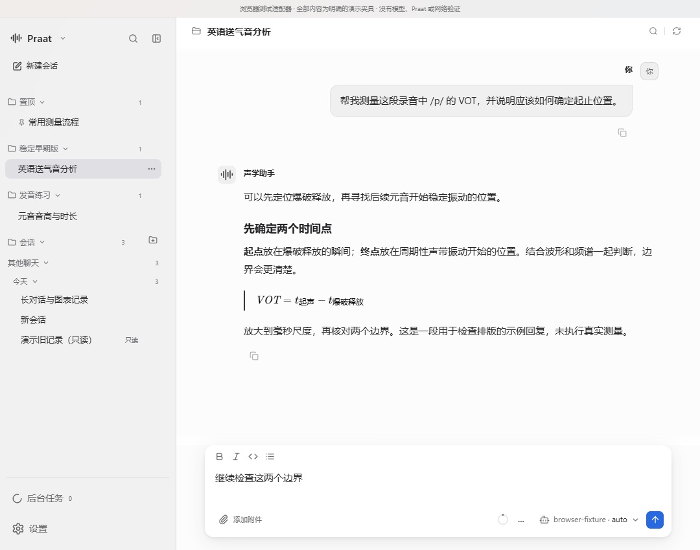
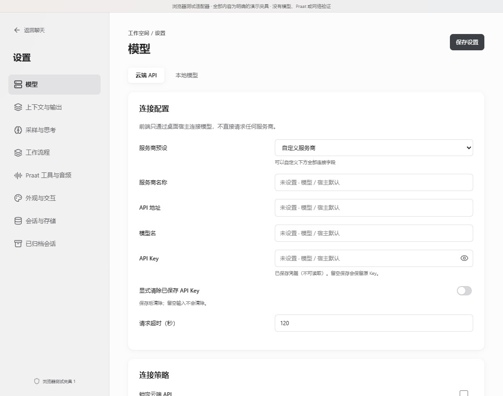
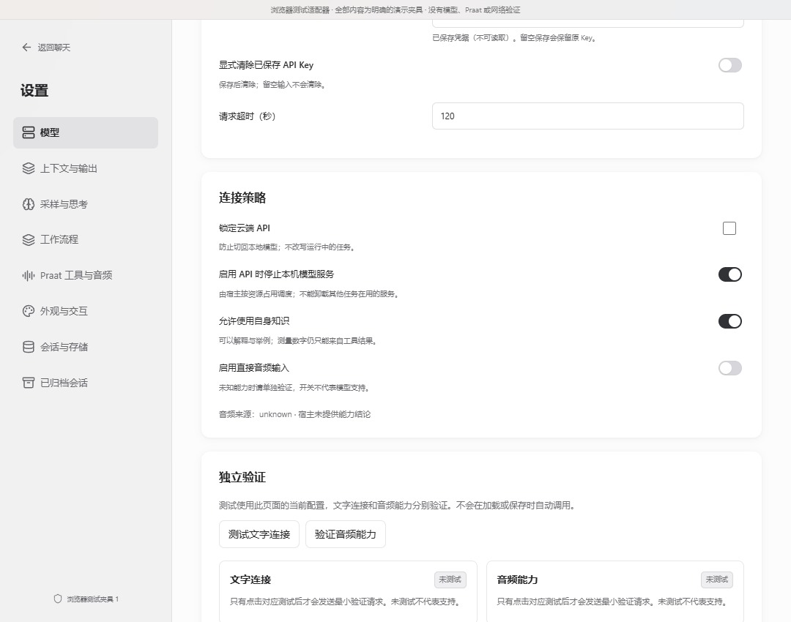
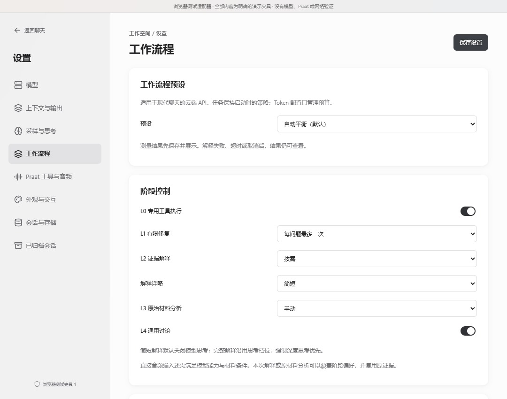
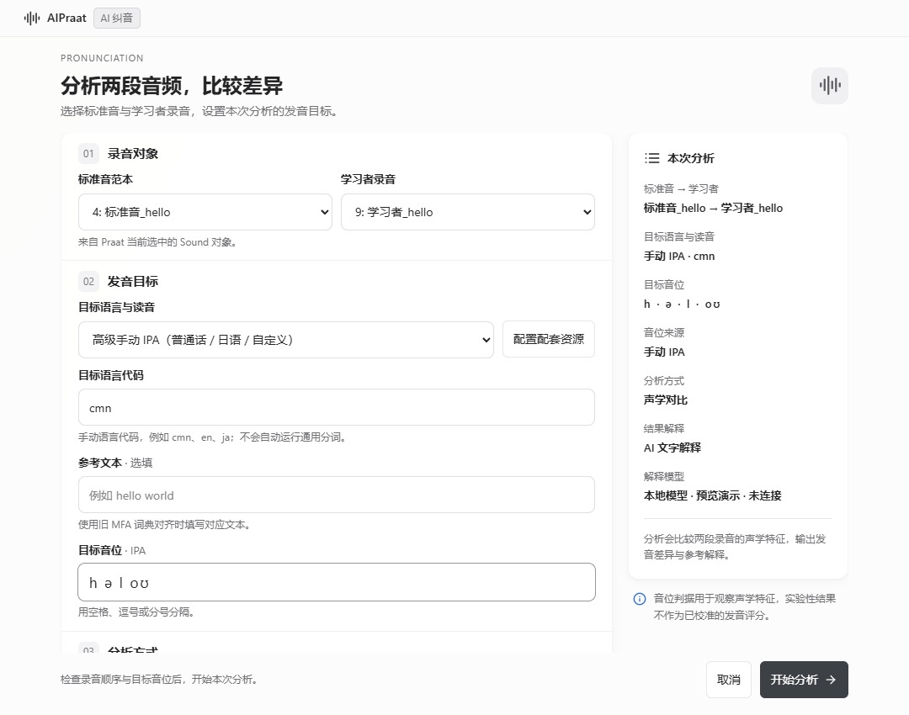
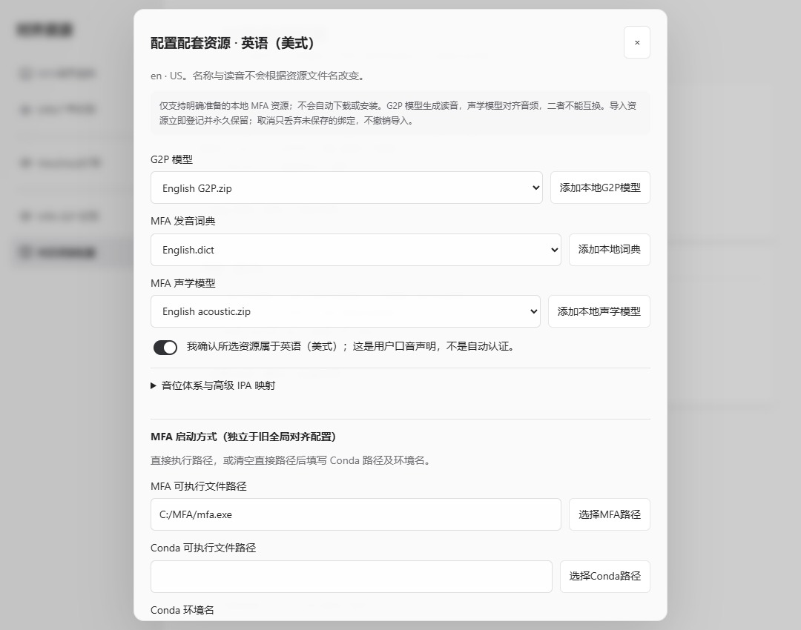

# WebView 前端视觉定稿

本文描述当前生产前端的视觉规范、参数与预览材料。尺寸随可用空间适配；预览资源不是生产资产。

**窗口背景不透明。** WebView2 原生背景只支持 alpha 0/255 两档，标题栏材质强于客户区且跨版本不稳定，因此生产实现使用不透明窗口基色 `--window-base`，主区与侧栏表面在其上分层；顶部 14px、底部 18px 为网页内的渐隐加模糊过渡，不透出桌面。

**设计预览与生产实现要分开看待。** 浏览器预览只验证视觉；生产前端、构建产物、真实 WebView2 宿主与桌面发布需分别核对。

## 1. 交接材料与优先级

材料均已复制到项目内，不依赖原会话的缓存目录。

| 材料 | 项目内位置 | 用途 |
| --- | --- | --- |
| 本设计文档 | `docs/ai-frontend/WEBVIEW-UI-DESIGN.zh-CN.md` | 最终要求、参数、边界和验收 |
| 定稿样例轮播 | `docs/ai-frontend/webview-ui-design/preview.html` | 自包含预览片段，含八个窗口场景 |
| 截图样例 | `docs/ai-frontend/webview-ui-design/examples/` | 最终视觉参照与辅助结构截图 |
| 预览参考代码 | `docs/ai-frontend/webview-ui-design/prototype/` | 样式参数、侧栏结构、输入框测量等实现线索 |

判断冲突时，以本文的最终参数和 `chat-final.jpg` 为准。参考 CSS 保留了多轮覆盖规则，应读取最终生效值，正式实现时整理为统一样式，避免继续堆叠覆盖。

`preview.html` 是 Codex 内嵌预览片段，依赖宿主提供轮播，不是完整独立网站；截图和本文不依赖该运行环境。辅助的 `composer-expansion-structure.png`、`scroll-fade-structure.png` 来自较早版本，**只参考扩宽和滚动关系，不参考其标题、公式、宽度或最终配色**。

## 2. 范围与设计方向

只调整原先绿色色调的 **WebView 层**：聊天、全部设置分类、AI 纠音、语音词典与模型管理、MFA 资源配套弹窗、Anki 连接，以及这些页面关联的菜单和对话框。原生 Praat 编辑器、菜单、波形等原生窗口不在改造范围内。

风格是低饱和黑白灰、扁平、安静、略带苹果式微透；图标、排版与层级接近用户提供的 Codex 截图。对话和输入区承担主要视觉重量，侧栏提供清晰导航。

- 主区域以白色为基础；大板块以接近白色的表面与细阴影分层。
- 灰色主要用于导航、选中状态、次要文字及小范围提示，避免满页灰色卡片。
- 蓝色只用于发送按钮及极少量错误／提示小图标；不要扩展到分区、标题、背景或聚焦大框。
- 删除、移除、丢弃等破坏性交互保留红色。
- 大块主要按钮使用柔和的近黑灰；按钮保持紧凑，不以放大按钮制造层级。

> **大块操作按钮使用低饱和蓝 `#4167aa`（悬停 `#355a95`）；开关选中与滑条已填充为 `#3f74c8`，开关未选中 `#dde5f1`，滑条未填充轨道 `#c3d3ec`；只有对话框发送键保留饱和蓝 `#2869df`。近黑灰不用于大块操作。**

**功能不能因换 UI 被删掉。** 保留侧栏分区、置顶、自定义分区、归档、历史会话、分组／排序、搜索、上下文菜单、多选、尺寸调节、长对话导航、附件、富文本工具、模型／上下文状态、快捷键、中文输入法保护、草稿和阅读位置，以及各独立窗口已有字段与操作。

## 3. 视觉参数

以下是当前浅色定稿的基准值；尺寸应随可用空间适配。

| 项目 | 定稿值 |
| --- | --- |
| 主区域表面 | `rgba(255,255,255,.95)`，约 95% 不透明 |
| 侧栏表面 | `rgba(244,244,245,.93)`，约 93% 不透明，比主区域更透 |
| 主文字／次要文字 | `#242426` / `#6e6e73` |
| 一般细边界 | `rgba(60,60,65,.12)`，按控件适当减弱 |
| 大按钮近黑灰／悬停 | `#3d4044` / `#33363a` |
| 发送蓝／破坏性红 | `#2869df` / `#b64142` |
| 白色板块表面 | `rgba(255,255,255,.86)` |
| 白色板块阴影 | `0 1px 3px rgba(25,28,34,.035), 0 2px 12px rgba(25,28,34,.045)` |
| 主表面背景模糊 | 预览使用 `blur(32px) saturate(.6)` |
| 一般板块／弹窗圆角 | 约 12px / 14px |
| 文本输入聚焦线 | 1px 中性灰；不要粗黑双层外框；错误态保留错误提示 |
| 字体 | 系统无衬线，现有正文偏好约 15px；不拉伸、压缩文字 |


## 4. 聊天与侧栏

### 顶部会话标题

- 仅保留文件夹图标和会话标题；去掉标题下原有模型／连接小字。
- 文件夹图标约 14px；标题 **14px、字重 600、行高 1.5**，视觉上只比图标略大一点。字号和字重不再增大。
- 标题栏约 42px 高，左右内边距 24px，无框线、无独立厚重色块。
- 顶部渐隐约 **14px**，比用户参照的 Codex 渐变区更窄。
- 右上搜索、刷新均为灰色，按钮 24px、图标 14px；两者之间加一条 **1px 宽、12px 高**的淡灰竖线。
- 长标题省略显示时保留原有可访问名称和查看完整信息的能力。

### 左上角与分区

- 品牌行由小图标、`Praat`、历史选项下拉、搜索和侧栏折叠入口组成，不显示“声学助手”副标题。
- 品牌图标约 18px，文字 16px；品牌行上／左右／下内边距约 **18 / 16 / 14px**；右侧按钮 28px，按钮间距 8px，避免挤在一起。
- 原先放大镜旁的箭头实际负责折叠侧栏，**不能删除该功能**；定稿改成明确的 `PanelLeftClose / PanelLeftOpen` 图标。
- 新建会话是紧凑的无大色块按钮，约 30px 高，带编辑图标。
- “会话”是可独立折叠的一级默认分区，收纳没有被用户手动分配到自定义分区的历史会话。置顶和自定义分区是同级结构。
- 原有项目／连接／时间分组保留。分区和分组的展开箭头移到标题右侧；计数靠后、操作靠右。
- 文件夹、分区标题用灰色，具体历史会话用深色；不要颠倒主次。
- 最内层历史会话相对原版向左移约 **4px**，预览将其左内边距从 20px 改为 16px。
- 搜索图标展开原有搜索输入；品牌下拉承接原有分组／排序菜单；新建分区入口保留。

### 正文、输入框与渐隐

- 默认会话带宽约 **720px**，正文在其中保留头像、间距和内边距；示例正文实际文字宽约 640px。
- 默认输入框外宽约 **720px**，比正文文字区宽一些。600px 窄输入框不再使用。
- 超过约三个可视输入行后自动扩宽，最大比当前会话带宽再增加 **96px**，始终受可用主区域宽度限制。例如 1080px 示例窗口内从 720px 扩至约 760px。
- 手动换行与自动折行都应参与判断；删回短内容后收窄。按固定的默认宽度测量内容，避免扩宽后行数减少又收窄、反复抖动。
- 原有会话宽度拖拽、键盘调节、偏好持久化继续工作。新默认值与已有用户保存的尺寸需分别处理，不重置用户配置。
- 输入框无黑色描边，使用约 14px 圆角和柔和阴影：`0 2px 5px rgba(32,32,36,.06), 0 7px 26px rgba(32,32,36,.075)`。
- 输入框只在最外层使用一层背景模糊，预览为 `blur(16px) saturate(108%)`，不要嵌套多层。
- 底部渐隐约 **18px**；应作用于滚动内容，不抹掉长对话缩略导航和宽度调节入口。
- 发送按钮约 **27×27px**，图标 16px，保留唯一主要蓝色强调。

## 5. 开关与表单

普通方框勾选型布尔开关统一改成小滑块：**32×20px**，白色滑块直径 **16px**，左右位移 12px。关闭底色 `#d7d7db`，开启底色 `#303236`；禁用态约 .45 不透明度。动画约 120ms，并尊重减少动画偏好。

**锁定类功能保留方框勾选样式**，例如“锁定云端 API”。原有互斥单选项仍是单选项，不改成可以同时开启的开关。

沿用原有 checked、disabled、标签点击、键盘空格、焦点和 React 状态更新。预览以原生 checkbox 换外观实现；正式组件化时保留原有行为和可访问名称。不要根据样式改掉业务含义。

表单输入保持轻边界。聚焦只显示一条 1px 灰线，预览使用 `#96969c`，避免边框再叠加粗 outline。错误状态仍可辨识，不能为外观移除校验消息。

## 6. 数学公式最终版

使用项目已有 `remark-math` / `rehype-katex` / KaTeX 及离线字体。

- 黑色 `#000`，字号约正文的 **1.2 倍**，常见示例约 17–18px。
- **字重 500**。不使用更粗的公式字重。
- 微斜；**大写字母也必须斜**，例如 `VOT`。预览对 KaTeX `.mathrm`、`.mainrm` 额外应用 italic，避免罗马体覆盖了斜体。
- 去掉公式灰色底壳、圆角和阴影。独立公式左侧使用 **2px、`#34363a`** 的近黑竖线，左侧内容内边距约 16px。
- 数学公式所在引用容器去底色，避免双层竖线；一般引用、代码块、表格和消息复制行为保留。

示例输入：

```latex
\mathrm{VOT} = t_{\text{起声}} - t_{\text{爆破释放}}
```

行内公式也沿用同一黑色与较轻斜体风格。不要通过正则把所有包含等号的自然语言或代码强行当作数学公式；预览样例使用的是实际数学渲染。

## 7. 最终样例

下列八张图与 `preview.html` 中的样例一致。均为真实 React 页面配合离线演示数据的截图，不代表已连接模型或执行过声学测量。

### 聊天与公式



### 模型设置：白色板块、细阴影、近黑按钮



### 普通滑块与锁定方框并存



### 工作流程



### AI 纠音与细聚焦线



### 语音词典与模型管理


### MFA 资源配套弹窗



### Anki 连接


长表单、弹窗内容仍按原设计滚动，截图之外的字段与操作没有被删掉。

## 8. 正式实现的入口与参考代码

| 实现入口 | 相关内容 |
| --- | --- |
| `ai/frontend/src/styles.css`、`src/pi/`、`src/codex/` 的样式 | 统一令牌、侧栏、菜单、归档和窗口外观 |
| `src/Chat.tsx` | 标题、操作区、渐隐、正文、长对话导航 |
| `src/pi/sidebar/Sidebar.tsx`、`src/HistoryOrganization.tsx`、`src/SidebarOptions.tsx` | 品牌行、真实默认分区、箭头位置、选项入口 |
| `src/Composer.tsx`、`src/layout.ts`、`src/Panes.tsx` | 输入框测量、响应宽度、尺寸持久化 |
| `src/Markdown.tsx` | 已有安全 Markdown 与数学渲染，主要调整其样式 |
| `src/Settings.tsx`、`src/WorkflowSettings.tsx` | 全部设置分类、布尔开关、锁定例外 |
| `src/PronunciationForm.tsx`、`src/SpeechDictionaries.tsx`、`src/MfaPresetEditor.tsx`、`src/AnkiIntegration.tsx` 及对应 CSS | 独立 WebView 页与资源弹窗 |
| `ai/praat_ai/modern_host.py`、`ui.py`、`speech_dictionaries.py`、`anki_integration.py` | 必要的 WebView 宿主外观适配与真实桌面验证 |

参考目录中的文件职责：

- `apple-webview-preview.css`：最终视觉参考；包含历史覆盖，需提取生效规则再整合。
- `preview-sidebar-top.tsx`：已确认的左上角结构。
- `preview-composer-layout.ts`：以默认宽度稳定测量可视行数的原型。预览阈值 `rows > 3.6` 为段落间距留了余量；产品行为是超过约三行扩宽。
- `preview-sidebar-transform.mjs`：记录预览对真实组件做过的内存变换，可查看改动目标；正式版本应直接修改组件，**不要保留字符串替换插件**。
- `apple-webview-preview.mjs`、`preview-window-fixtures.ts`：仅用于离线预览；演示适配器、背景壁纸、测试录音与固定历史记录不得接入生产运行。
- `gradient-grid-sources.md`：参考来源和阶段边界。

预览脚本依赖当前项目的 frontend/node_modules，并使用当前机器的项目绝对路径。只阅读文档和截图不需要启动服务器；需要交互预览时，可在确认端口 5191 空闲后运行 `node docs/ai-frontend/webview-ui-design/prototype/apple-webview-preview.mjs`。工作区位置变化后需相应更新预览脚本中的路径。

## 9. 实施验收

浏览器预览检查覆盖普通开关的标签点击／空格切换、锁定方框例外、细聚焦线、设置分类、资源与删除弹窗、IPA 判据切换、未保存提示、输入框扩宽与收窄、长对话导航及小窗口布局。预览结论不代替生产前端与真实宿主验证。

正式实施至少覆盖：

1. 对照最终八张样例，验证层级、标题字重、近黑按钮、稀少蓝色、删除红色、白色板块与轻阴影。
2. 检查全部设置分类，以及纠音、词典／声学模型／Wav2Vec2／G2P／配套资源、Anki 页面，原有字段、入口和确认流程齐全。
3. 检查分区独立折叠、默认会话归属、搜索、分组／排序、置顶、归档、菜单与侧栏折叠，不能只验证静态画面。
4. 检查输入框短文本、四行、自动折行、删短、窗口缩放；扩宽稳定，且不破坏 IME、快捷键、附件、草稿或持久化尺寸。
5. 检查行内／独立公式、大写字母斜体、较轻字重、无灰底、近黑竖线，以及普通引用、代码、表格和复制行为。
6. 检查键盘焦点、禁用态、锁定例外，以及小窗口中的字段和底部操作可达。预览覆盖的宽度包括 1080、860、620、600、375px，按各窗口实际最小尺寸验收。
7. 在真实 Windows 桌面更换背后窗口／壁纸颜色，确认外观不依赖桌面材质，主区与侧栏的不透明基色正确；不以浏览器背景模拟代替宿主验收。
8. 执行与实际改动相符的现有前端构建和测试。区分源码修改、构建产物及桌面发布；保留工作区原有其他改动，不顺手覆盖、打包或发布未请求的内容。

## 10. 参考来源与复用边界

- Codex 的标题比例、文件夹位置和灰白层级参考用户截图。本轮没有找到对应桌面 React 渲染器的公开源码，不能把截图复刻说成直接复制了 Codex 桌面实现。项目既有协议与来源记录见 `FRONTEND-SOURCES.md`。
- [PI-Desktop chat-shell.css](https://github.com/vastsa/PI-Desktop/blob/0d47d26769ecbeca1c3ab56fa83b58a91de8190e/apps/desktop/src/styles/chat-shell.css)：滚动区域 mask 渐隐方法，定稿缩短了过渡范围。
- [PI-Desktop Composer.tsx](https://github.com/vastsa/PI-Desktop/blob/0d47d26769ecbeca1c3ab56fa83b58a91de8190e/apps/desktop/src/components/Composer.tsx)：基于内容高度和行高测量的思路；固定默认宽度测量及自动扩宽是本项目预览的适配。沿用既有 LGPL-3.0 来源记录。
- [Codex-Dream-Skin windows-shell.css](https://github.com/Fei-Away/Codex-Dream-Skin/blob/6fc42df48a6a5365011f55cc349e20c038e56d1d/tools/windows-shell.css)：非官方主题对单层输入框模糊的处理参考；阴影由本预览本地调整。
- 图标、编辑器、数学渲染等继续复用项目已有 Lucide、Tiptap、KaTeX 等依赖。用户接受从合适的开源实现复用积木；实现效果与功能完整性优先，保留实际复用来源和许可记录。
