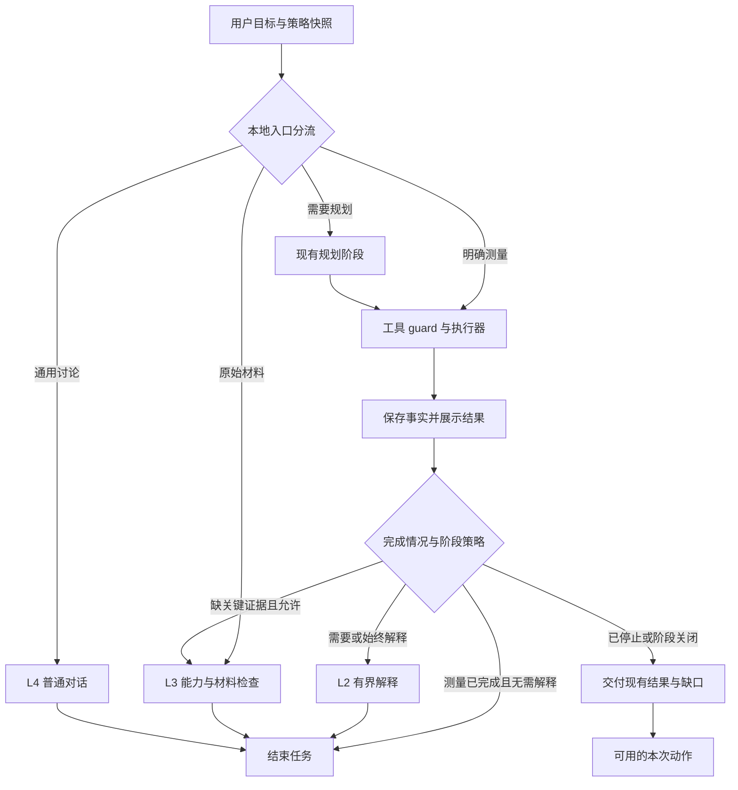

# AIPraat：可配置工作流程与快速结果交付

日期：2026-10-06。状态：已实施；离线验证及边界见[实施记录](../../2026-10-06-workflow-implementation.md)。范围：现代聊天前端的云端 API 流程。

同日回归修订见[练习建议与解释分流修复](../../2026-10-06-workflow-advice-regression.md)：按需解释以目标完成事实为依据，不能仅靠关键词白名单；练习方法问题复用历史证据直接对话。

## 1. 设计决定

**测量结果取得并通过必要校验后立即交付；解释、复核和原始材料分析根据目标与用户设置启动。** L0–L4 是可选择的工作方式，不是每个任务必须逐级经过的流水线。

保留现有 Python、Pydantic AI／pydantic-graph 2.52.0、React、Praat 执行器和代码 guard。沿用 [Pi 上下文／缓存设计](2026-10-06-pi-context-cache-skills-design.md) 的原生消息链、阶段配置、共享任务状态与会话 runtime；本设计调整阶段何时执行。

本设计替代原阶梯设计中“正常测量完成后必进 L2”的约定，以及根据 `limit_tokens` 决定是否自动进入 L3／L4 的约定。Token 配置只管理容量与预算；阶段是否进入由工作流程策略决定。原对象与范围绑定、知识权限、音频能力、取消、投递事实及工作量上限继续生效。

首版不扩展本地模型或旧 Tk 设置窗口。新面板明确显示适用于云端 API，避免把尚未接入的路径展示为已生效。

## 2. 当前代码依据与瓶颈

以下是编写设计时的源码观察，不代表本设计已经实现：

| 接入点 | 当前行为 | 本次修改方向 |
| --- | --- | --- |
| [cloud_agent.py](../../../ai/praat_ai/cloud_agent.py) 的 `_run()` | execute 节点返回 L2，图边固定从 execute 进入 report | 增加完成判定与条件边，允许直接交付 |
| [dialogue_policy.py](../../../ai/praat_ai/dialogue_policy.py) 的 `direct_measurement()` | 仅有明确的当前声音总时长匹配 | 保留保守匹配，逐项扩展有确定参数契约的测量 |
| [modern_execution.py](../../../ai/praat_ai/modern_execution.py) | 已有时长快路；其他分析使用工具规划与报告；快路还受附件和 `force_high` 判据影响 | 将“是否需要模型解释”与思考档位分开，接入统一策略与结果交付 |
| [modern_settings.py](../../../ai/praat_ai/modern_settings.py)、[Settings.tsx](../../../ai/frontend/src/Settings.tsx) | 设置通过宿主保存，运行中任务保持启动时配置 | 新增工作流程配置和面板，复用保存与任务快照语义 |
| [escape_policy.py](../../../ai/praat_ai/escape_policy.py) | 已有原目标、证据、交付项、失败／停滞计数和共享预算 | 补充策略与完成判定，避免新建另一套执行事实 |

优化优先级是减少不必要的请求，再缩短必要请求，最后测量缓存收益。`return_direct` 只能省掉工具后的模型调用；零模型调用还需要本地明确目标和参数。

## 3. 设置面板

在设置中新增“工作流程”。面板先提供预设，再展示各阶梯的控制项；修改任一项后预设显示为“自定义”。保存沿用现有保存按钮、未保存提示和宿主接口，不写浏览器存储。

| 阶梯 | 用户控制 | 执行约定 |
| --- | --- | --- |
| L0 专用工具执行 | 启用／关闭 | 包含本地直接测量和模型规划后的 Praat 操作；关闭后两者均不得执行 |
| L1 有限修复 | 关闭／每问题最多一次 | 针对已有具体错误进行有依据的修正；次数由后端约束，不允许换参数重置问题计数 |
| L2 证据解释 | 关闭／按需／始终；简短／完整 | 按需只在单项目标已被证明完成且无需解释时省略；自然问句不能因漏掉关键词而只收到工具行。始终表示工具流程结束后生成一次解释，不要求其他入口绕行 L2 |
| L3 原始材料分析 | 关闭／手动／自动 | 手动允许明确的原始材料分析请求或继续按钮；自动仅在目标需要、关键证据缺失且材料与能力可用时进入 |
| L4 通用讨论 | 启用／关闭 | 允许直接聊天／概念解释／练习方法；练习建议可复用历史证据，不重新测量，不能用一般讨论冒充已完成具体录音诊断 |

音频能力开关与 L3 策略同时成立才可发送音频。L3 自动不表示每轮上传；不能发送录音作为能力探针。关闭 L0 时，不能通过 L3 导出动作绕过禁用的 Praat 操作；已有文件或可用片段可以直接使用。

| 预设 | 初始配置 | 使用意图 |
| --- | --- | --- |
| 快捷结果 | L0 开；L1 关；L2 关；L3 手动；L4 开 | 测量完成即交付，后续解释由用户启动 |
| 自动平衡（默认） | L0 开；L1 每问题一次；L2 按需／简短；L3 手动；L4 开 | 简单任务快交付，需要解释的任务自动解释 |
| 深度分析 | L0 开；L1 每问题一次；L2 始终／完整；L3 自动；L4 开 | 保留较充分的模型分析与能力恢复路径 |
| 纯聊天 | L0 关；L1 关；L2 关；L3 关；L4 开 | 只进行通用对话，不初始化 Praat 执行流程 |

高级项仅提供 L2 的阶段时间上限与实际请求上限：快捷结果／自动平衡初值为 15 秒、1 次；深度分析为 60 秒、2 次。快捷结果关闭 L2 时这两个值仅用于显式的本次解释。用户可修改为自定义，仍受任务总预算约束。这些数值是初始产品默认值，尚未通过真实供应商性能验收。

## 4. 配置、优先级与预算

建议配置落在 `modern.workflow`，宿主 `settings.get/save` 返回／接收独立 `workflow` 段。Python 定义有类型的 `WorkflowPolicy`；前端使用对应字段与枚举，后端校验后才能落盘。

```json
{
  "schema_version": 1,
  "preset": "balanced",
  "l0_enabled": true,
  "l1_repair_limit": 1,
  "l2_mode": "on_demand",
  "l2_detail": "brief",
  "l2_deadline_sec": 15,
  "l2_request_limit": 1,
  "l3_mode": "manual",
  "l4_enabled": true
}
```

字段范围：`preset=fast|balanced|deep|chat|custom`；L1 为 0／1；L2 为 `off|on_demand|always`；详略为 `brief|full`；L3 为 `off|manual|auto`；L2 时间为 1–3600 秒，请求数为 1／2。布尔值和数值必须按真实类型校验；缺字段补默认，非法值返回清楚的保存错误。保存其他设置时不覆盖工作流程，保存工作流程时不覆盖未知旧配置或凭据。

旧配置首次读取采用自动平衡，不触发模型请求；首次主动保存才持久化新段。启动任务时保存完整有效策略快照，之后的设置变化用于下一任务。旧会话可以继续查看，不能因为增加面板自动恢复任务。

优先级：

1. 对象／材料、真实能力、知识权限、取消、投递 unknown 和总预算等执行条件不可由面板覆盖。
2. 用户明确的单次动作可以覆盖阶段偏好。例如“本次解释”“本次分析原材料”的按钮，或清楚的一次性文字指令；记录覆盖与来源，不修改全局设置。
3. 其余入口和自动恢复服从启动时的工作流程快照。普通目标不能默默打开关闭的阶梯。

L1 控制工具执行问题的有限修正，不等同于 L2 的输出校验重试或传输重试。所有实际模型请求，包括传输重试、报告定点修正、续写、音频重定向和必要压缩，均计入已有任务总账；L2 自身还受阶段上限约束。

L2 时间从开始准备该阶段到完成校验和保存为止，以单调时钟计量。每次 HTTP 请求的有效超时取剩余阶段时间与原 API 请求超时的较小值；修正／重试不能各自获得新的完整阶段时间，阶段内压缩也消耗时间。超时后终止本阶段，保留已交付结果，不自动转入另一长流程规避上限。L3／L4 继续使用各自现有请求配置与共同任务预算。

思考档位只影响实际发生的模型请求。确定性测量不因 `force_deep_thinking` 被强行改成模型流程；用户明确要求深度解释时，按目标和策略进入解释阶段。

## 5. 入口与条件路由

不新增付费的分类模型。复用保守本地分流，并增加可检查的任务契约与完成判定。

| 目标类型 | 路径 | 完成标准 |
| --- | --- | --- |
| 本地可确定参数的单项测量 | 本地目标／参数 → 同一工具 guard 与执行器 → 结果 | 所需量、对象、范围及结果匹配，交付状态已知；零模型请求 |
| 需要模型选择工具的测量 | 规划 → 工具 → 结果；满足条件时结束规划，按策略决定 L2 | 用户所需交付项全部有依据；不为宣布完成增加一轮模型调用 |
| 解释、比较、综合判断 | 必要测量 → 先交付结果 → 按需 L2 | 测量与解释分别完成；L2 关闭则说明解释尚未执行并提供本次解释入口 |
| 原始材料分析 | 能力与策略检查 → L3 | 只在真实输入材料后形成对应观测；不先后重复生成同义 L2 报告 |
| 通用聊天／概念解释／练习方法 | L4 | 使用现有普通对话入口；已有证据追加到当前阶段的消息尾部，不初始化对象、规划工具或报告阶段。明确要求测量、分析或操作录音的复合目标仍走专业流程 |
| 不明确或不支持的目标 | 现有保守规划／能力检查，或展示缺口 | 不因为存在任意一条证据就判为完成，也不误分流成闲聊 |

完成判定至少检查：原始交付项、对象／材料版本、时间范围、工具成功与有效结果、真实投递状态，以及是否尚需解释。失败、未执行、unknown、缓存重复或文件名线索不能充当新增成功测量。

首批确定性测量沿用现有总时长；扩展 F0、强度等明确单项统计时，逐项声明工具映射、统计量、单位、范围和默认参数并验证。VOT 边界依赖、诊断、标准发音比较及复合任务不能仅凭关键词直达工具。未知对象／参数不猜测，不为覆盖率增加泛化规则。

在工具结果进入 TaskState 后运行完成检查。只有应用能证明交付项完成的调用集合才提前结束规划；混合工具调用、未执行的调用和未完成的目标保持现有循环与预算。结束时仍完整保存已执行的 tool call／return 配对；未执行调用不得伪造成功返回。



图中的每条边均服从启用状态、共享预算和取消。L1 在工具具体失败时作为有限修复支路；关闭或修正失败后立即退出对应分支，再由相同策略决定收尾方式。没有可执行的后续阶段时，用本地模板交代已有结果与缺口，不额外调用模型生成失败说明。

## 6. 结果展示、保存与继续

结果交付是独立职责，不是新建 L5。尽量复用现有工具活动与宿主事件，补充结果展示和持久化契约，而不是平行创建第二套证据仓。

结果至少包含量名、值、单位、对象／材料、范围、来源／证据引用，以及成功、失败、未执行或 unknown 状态。后端从结构化工具结果生成卡片与简短正式文字；不由模型重新抄写测量值。摆放、标注等操作展示真实交付事实，不能根据测量成功推断后续副作用已成功。

先保存并展示结果，再启动需要的解释。界面区分“测量已完成，正在解释”与“整个目标已完成”。解释更新独立区域，不覆盖已发布测量；取消、超时或报告校验失败后结果仍可查看，未验证草稿不成为正式答案。

仅测量目标满足时可标记 `complete`；包含解释的目标在解释缺失时标记 `partial`，提供明确缺口。不能复用当前 `fallback_report()` 的“目标分析尚未完成”模板去标记已完成的纯测量任务。

“解释结果”“分析原材料”“通用讨论”等本次动作，仅在其实际能力和材料条件满足时展示。点击沿用原目标、材料版本和已成功证据，作为新的可见用户动作／分析轮次记录；不重新测量，不恢复暂停的失败分支，也不更改全局预设。源材料不可用时保留证据阅读与解释能力，不能冒充可重新听到原音频。

## 7. 与 Pi、技能、缓存及 guard 的衔接

- 会话继续保存正式对话与 SDK 原生消息；planner／report／dialogue 保持各自合法的配置和消息链。跳过 L2 不创建空报告上下文，也不将工具协议塞进普通对话链。
- 工作流程策略在代码层判断；模型只收到必要的任务指导。详略和本次目标在尾部追加，不能把整份设置、阶段开关或活动卡片反复放到前导 system 中。
- L1 开关改变后端修正政策，不随每次切换重排工具声明或改写已有消息。L0 关闭时不启动工具规划；真正改变静态工具／输出协议或压缩历史时，沿用已有配置版本边界。
- 测量直接交付仍通过现有 schema、对象／范围、结果有效性和投递检查。必要的 L2 报告仍通过现有报告 guard；这些检查不在面板上作为可关闭的阶梯。
- 保留 filename 发音线索回退：无词典且用户未说明时才作为候选，注明来源；不计为测量证据、不证明声学结论、不自动打开 L3。
- 不新增缓存预热、保活请求、供应商未经验证的字段或第二个路由模型。缓存命中的 token 仍占上下文；缺报缓存计数保持 null。

## 8. 源码参考与适配边界

| 来源 | 已核实的参考 | 采用方式 |
| --- | --- | --- |
| Zoo Code，提交 `d7963fc2db8ff07189e9f22079b15d67ad3a8bfd` | [ModesView.tsx](https://github.com/Zoo-Code-Org/Zoo-Code/blob/d7963fc2db8ff07189e9f22079b15d67ad3a8bfd/webview-ui/src/components/modes/ModesView.tsx#L489) 的工具组开关；[CustomModesManager.ts](https://github.com/Zoo-Code-Org/Zoo-Code/blob/d7963fc2db8ff07189e9f22079b15d67ad3a8bfd/src/core/config/CustomModesManager.ts#L404) 的保存前校验 | 借鉴预设／自定义、复选框与校验交互；采用本项目宿主保存接口，工具权限模式不直接等同于阶梯 |
| OpenCode，提交 `f03046d9f558bc54a090363fea48441b05f522bf` | [agent.ts](https://github.com/anomalyco/opencode/blob/f03046d9f558bc54a090363fea48441b05f522bf/packages/opencode/src/agent/agent.ts#L267) 应用禁用、步数与权限配置；[prompt.ts](https://github.com/anomalyco/opencode/blob/f03046d9f558bc54a090363fea48441b05f522bf/packages/opencode/src/session/prompt.ts#L1279) 的末步收尾提示 | 借鉴有类型的执行配置；本项目次数／时间限制由后端执行，不能只复制提示模型收尾的做法 |
| LangChain／LangGraph，提交 `67ba389f4a85dbb98fca475619670a99b23d399d` | [agents/factory.py](https://github.com/langchain-ai/langchain/blob/67ba389f4a85dbb98fca475619670a99b23d399d/libs/langchain_v1/langchain/agents/factory.py#L2072) 检查已执行工具的 `return_direct` 并选择结束边 | 在现有 pydantic-graph 实现条件边；按本次目标完成程度决定，不把同一工具永久标成直接结束；不迁移框架 |

对应许可证为 [Zoo Code Apache-2.0](https://github.com/Zoo-Code-Org/Zoo-Code/blob/d7963fc2db8ff07189e9f22079b15d67ad3a8bfd/LICENSE)、[OpenCode MIT](https://github.com/anomalyco/opencode/blob/f03046d9f558bc54a090363fea48441b05f522bf/LICENSE)、[LangChain MIT](https://github.com/langchain-ai/langchain/blob/67ba389f4a85dbb98fca475619670a99b23d399d/LICENSE)。这里只记录设计借鉴；若复制实际代码，随代码保留对应来源和许可信息。

## 9. 实施顺序与验收

1. 先抽出本地结果交付与任务完成判定；使已覆盖的确定性测量保持零模型请求，并为规划后的工具结果增加直接结束边。
2. 接入 `WorkflowPolicy`、有界 L2 与各恢复入口；逐条消除强制报告及 `limit_tokens` 对阶段自动启用的隐式影响。
3. 接入工作流程面板、预设、自定义、保存和任务快照；补齐先结果后解释与本次继续动作。
4. 执行有意义的协议／行为回归，完成前端构建与页面验证；汇报真实改动与未验证边界。

| 验收场景 | 必须满足 |
| --- | --- |
| 自动平衡下明确总时长，及已纳入快路的单项测量 | 零模型调用，使用同一 guard／执行器，结果与旧工具一致；不创建 L2 |
| 需要规划但交付项已证明完成的测量 | 无额外的完成宣布请求、无 L2 请求；不能错误结束混合／未完成调用 |
| 测量并解释，或深度分析预设 | 结果先展示；只生成必要分析，L2 关闭时明确解释缺口 |
| L0／L1／L2／L3／L4 分别关闭 | 所有入口、快路、继续与恢复路由服从策略；关闭步骤不会在 fallback 中偷偷执行 |
| L2 修正、续写、超时或取消 | 实际请求不超阶段与任务上限，重试不重置时间；结果持久保留，未验证正文不正式提交 |
| 设置保存、重开、旧配置与任务中更改 | 默认／枚举正确，宿主持久化，保存其他设置不丢字段；活动任务保持快照 |
| 后续本次解释／听音频 | 绑定原证据与材料，不重复测量，不改变全局偏好；实际能力不满足则不显示可执行入口 |
| 三次连续请求与必要报告修正 | 同配置下真实 HTTP 消息前缀按原顺序追加；静态规则／工具／schema 稳定；预算与事实不因阶段／压缩重置 |

扩展相关测试：`test_dialogue_measurement`、`test_dialogue_fastpath`、`test_cloud_escape`、`test_cloud_protocol`、`test_dialogue_protocol`、`test_phase_context`、`test_report_guards`、`test_tool_guards`、`test_delivery_state`、现代设置与前端导航／保存测试。关注行为与真实请求数，不逐字镜像提示词。

记录路由原因、策略快照／单次覆盖、结果首次可见时间、规划／工具／L2 耗时、实际模型请求／重试数及现有缓存读写与总输入。分开汇报零请求快路和需要规划的任务；“一秒出结果”只能作为适用轻量工具的测量目标，不作为所有分析的承诺。真实云端 A/B 或上传录音另按已授权范围执行，本设计与离线回归本身不发付费请求。
